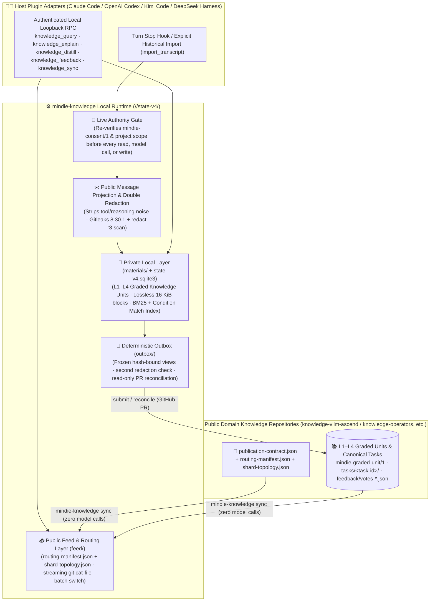

<p align="center">
  
</p>

<h1 align="center">MindIE Knowledge</h1>

<p align="center">
  <strong>Verifiable Domain Memory for AI Coding Agents — L1–L4 Graded Knowledge Units, Hierarchical Shard Routing, Condition-Matched Local BM25 Retrieval, Double Fail-Closed Redaction & Self-Evolving Experience Loop</strong><br>
  <sub>Part of <a href="https://github.com/mindie-agent/mindie-agent">MindIE Agent</a> · Python package <code>mindie-knowledge</code> (module <code>mindie_knowledge</code>)</sub>
</p>

<p align="center">
  <a href="https://github.com/mindie-agent/mindie-agent"></a>
  <a href="pyproject.toml"></a>
  <a href="https://github.com/mindie-agent/knowledge-vllm-ascend"></a>
  <a href="mindie_knowledge/redact.py"></a>
  <a href="LICENSE"></a>
  <a href="LICENSE-CORPUS"></a>
</p>

<p align="center">
  <a href="README.md">中文</a> · <strong>English</strong> · <a href="#-one-sentence-agent-native-install">⚡ One-Sentence Install</a> · <a href="#-what-problem-does-it-solve">✨ Why It Exists</a> · <a href="#-official-public-domain-knowledge-repositories">🌐 7 Domain Feeds</a> · <a href="#️-architecture--two-way-experience-flywheel">🏗️ Architecture</a> · <a href="#-inside-a-redacted-task-package">📦 Package Anatomy</a> · <a href="#️-cli--loopback-rpc-reference">🛠️ CLI & RPC</a> · <a href="docs/README.en.md">📚 Docs</a>
</p>

---

## ⚡ One-Sentence Agent-Native Install

### Option 1: Install via Your Coding Agent in One Sentence (Recommended ✨)

`mindie-knowledge` is the shared knowledge runtime inside [MindIE Agent](https://github.com/mindie-agent/mindie-agent). You don't need to manually configure background services or databases—just open **Claude Code**, **OpenAI Codex CLI**, **Kimi Code**, or **DeepSeek Harness (`mindie-agent-dsh`)** and send this single sentence to your Agent:

```text
帮我安装一下这个 https://github.com/mindie-agent/mindie-agent
```

Your Agent will automatically install the matching native plugin (`mindie-agent-cc`, `mindie-agent-codex`, `mindie-agent-kimi`, or `mindie-agent-dsh`), provision the pinned `mindie-knowledge` runtime, and sync the public [`knowledge-vllm-ascend`](https://github.com/mindie-agent/knowledge-vllm-ascend), [`knowledge-operators`](https://github.com/mindie-agent/knowledge-operators), and companion domain corpora in the background.

<details>
<summary>🤖 <b>AI Agent Auto-Install & Configuration Guide (Instructions for AI Agents)</b></summary>

> **Instructions for AI Agents**:
> 1. **Full MindIE Agent Setup in Claude Code / Codex / Kimi Code / DeepSeek Harness (`mindie-agent-dsh`)**:
>    Read the main repository homepage at [`https://github.com/mindie-agent/mindie-agent`](https://github.com/mindie-agent/mindie-agent), detect your host client environment, and run the corresponding plugin installation commands. The host plugin automatically manages the `mindie-knowledge` virtual environment, service lifecycle, and local search index.
> 2. **Standalone Developer / CI Installation of `mindie-knowledge`**:
>    Ensure Python 3.11+ and Git are installed, then run:
>    ```bash
>    # Install the runtime package from this repository
>    python3 -m pip install -e .
>
>    # Install with test dependencies for local development
>    python3 -m pip install -e '.[test]'
>    ```
> 3. **Common Verification & Standalone Commands**:
>    ```bash
>    # Check the active deterministic redaction ruleset profile (currently r3)
>    python3 -m mindie_knowledge.redact --profile
>
>    # Sync the latest public knowledge feed (zero model calls; works with community sharing off)
>    mindie-knowledge sync --config domain.json
>
>    # Inspect local service health, corpus counts, and sharing status
>    mindie-knowledge status --config domain.json
>    mindie-knowledge sharing-status --config domain.json
>    ```

</details>

---

## ✨ What Problem Does It Solve?

When working on Ascend NPU inference engineering (such as `vLLM-Ascend` operator adaptation, CANN graph compilation, or multi-device HCCL debugging), developers and AI Agents face three recurring pain points:

1. **General-purpose LLMs lack domain-specific troubleshooting memory**: Every new session starts from scratch, repeating the same dead ends on environment variables, operator signatures, and precision checks;
2. **Naive "LLM-summarized memory" destroys crucial evidence**: Letting an LLM rewrite debugging logs strips away exact stack traces, flags, and failed control experiments—or worse, hallucinates unverified claims;
3. **Strict privacy requirements block raw log sharing**: Raw session transcripts contain internal IPs, SSH login targets, personal home paths, and credentials that must never leak to public repositories.

**`mindie-knowledge` solves all three with a clean, deterministic architecture:**

| Core Capability | How It Works in Plain English |
| --- | --- |
| **📐 L1–L4 Graded Knowledge Units (`mindie-graded-unit/1`)** | Organizes engineering knowledge into four structured tiers: **`L1 canonical-fact`** (hardware/framework invariants), **`L2 sop`** (standard troubleshooting & verification procedures), **`L3 workflow`** (multi-stage development & tuning workflows with Hermes convergence), and **`L4 optimization-pattern`** (verified optimization patterns with de-biased exploration), complete with parent-rule inheritance and explicit `applicability` predicates. |
| **🧭 Hierarchical Shard Routing & Condition-Matched Retrieval** | Combines `routing-manifest.json` and `shard-topology.json` hierarchical shard routing with `applicability` condition matching and a local **BM25 + exact-identifier lexical index** to retrieve matching units in milliseconds—**zero model calls, zero network requests, and no resident search daemon**. |
| **📖 Browse the Outline First, Read Exact Units or Blocks on Demand** | Supports both `mindie-graded-unit/1` graded units and `state-v4` task packages (`index.md` navigation manifest plus lossless 16 KiB material blocks `blocks/<block_id>.md`). Agents inspect summaries and applicability first and open only the units or blocks they actually need. |
| **⚗️ Evidence-Driven Distillation (`knowledge_distill`) & Sync (`knowledge_sync`)** | Distills verified debugging and optimization evidence into structured graded units via `knowledge_distill`, incrementally syncs upstream corpora via `knowledge_sync`, and enforces schema, shard-topology, and privacy gates in CI via `publication_check`. |
| **🛡️ Double Fail-Closed Privacy Redaction** | Community sharing is **off by default (Opt-in)**. When enabled, only user prompts and visible assistant replies are extracted (stripping tool noise and hidden reasoning), then scanned by **Gitleaks + `mindie_knowledge.redact` (`r3`)** before storage and before export—never letting an LLM rewrite body text. |
| **📮 Deterministic Outbox & Read-Only Reconciliation** | Packs indexed local drafts, graded units, and publishable feedback votes into `mindie-contribution/1` batches for GitHub PR delivery. If a network call times out or leaves an `unknown` result, it reconciles via read-only remote checks—**never blindly replaying writes or repeating paid model calls**. |
| **👍 Revision-Bound Usefulness Feedback** | After using an entry in real work, Agents can record an `up` or `down` vote bound to the exact observed revision (`@<observed-revision>`), helping surface proven fixes without treating votes as blind authority. |

---

## 🌐 Official Public Domain Knowledge Repositories

`mindie-knowledge` powers **7 official public domain knowledge repositories** under `@mindie-agent`, each governed by `routing-manifest.json`, `shard-topology.json`, and `publication_check` CI validation for `L1–L4` graded units (`mindie-graded-unit/1`):

| Repository | Domain ID (`domain`) | Scope & Coverage |
| --- | --- | --- |
| **[`knowledge-vllm-ascend`](https://github.com/mindie-agent/knowledge-vllm-ascend)** | `vllm-ascend` | `vLLM-Ascend` 0-day model adaptation (DeepSeek / Qwen / Kimi, etc.), ACLGraph/TorchAir graph compilation, MoE EP/MC2, quantization, and accuracy/performance tuning |
| **[`knowledge-operators`](https://github.com/mindie-agent/knowledge-operators)** | `operators` | Ascend 910B / 910C (A3) / 950 (A5) operator engineering: `AscendC`, `Triton-Ascend`, `CATLASS`/`TileLang`, FIA/FlashMLA, and fused kernel optimization |
| **[`knowledge-infer-core`](https://github.com/mindie-agent/knowledge-infer-core)** | `infer-core` | Core inference engine scheduling, Continuous Batching, PagedAttention / KV Cache management, Speculative Decoding, and prefix caching |
| **[`knowledge-infer-distributed`](https://github.com/mindie-agent/knowledge-infer-distributed)** | `infer-distributed` | Multi-node / multi-card distributed inference, TP/PP/DP/EP parallelism, PD disaggregation, HCCL/RoCE troubleshooting, and collective communication tuning |
| **[`knowledge-infer-observability`](https://github.com/mindie-agent/knowledge-infer-observability)** | `infer-observability` | Inference observability & profiling: `msprof` trace analysis, Host-Device bottleneck attribution, memory breakdown, and Roofline modeling |
| **[`knowledge-infer-ops-compat`](https://github.com/mindie-agent/knowledge-infer-ops-compat)** | `infer-ops-compat` | CANN / driver / firmware / PyTorch (`torch_npu`) cross-version compatibility matrices, Ascend environment setup, container images, and build toolchains |
| **[`knowledge-agent-engineering`](https://github.com/mindie-agent/knowledge-agent-engineering)** | `agent-engineering` | AI Coding Agent engineering practices, Harness plugin boundaries, benchmark design, progressive context disclosure, and self-evolving knowledge workflows |

---

## 🏗️ Architecture & Two-Way Experience Flywheel

### 1. End-to-End Pipeline



### 2. Three Orthogonal Local Storage Layers (`<root>/<domain>/state-v4/`)

| Storage Layer | Authoritative Contents | Why It Is Designed This Way |
| --- | --- | --- |
| **Public Feed Layer (`feed/`)** | Shallow Git cache + verified `tasks/<task-id>/` read-only package view | Follows upstream commits, streaming blobs one at a time through a persistent `git cat-file --batch` pipe. Switches the active view atomically only after full verification; bad candidates never corrupt the existing cache. |
| **Local Material & Index Layer (`materials/` + `state-v4.sqlite3`)** | Ordinary Markdown block bodies + SQLite metadata/cursors/ledgers + ReMe term-count checkpoints | **Markdown files are always the source of truth for body bytes.** SQLite holds only compact pointers, cursors, and attempt receipts. Derived BM25 indexes can be rebuilt from Markdown files at any time. |
| **Outbox & Sharing Layer (`outbox/`)** | Frozen outbound package views + publication ledger | Active only when community sharing is enabled. Model outputs commit before local application, and uncertain network writes (`unknown`) stay frozen for read-only reconciliation. |

---

## 📦 Inside a Redacted Task Package

Every task package (both local drafts and public packages in [`knowledge-vllm-ascend`](https://github.com/mindie-agent/knowledge-vllm-ascend)) uses a clean content-addressed structure under `tasks/<64-hex-task-id>/`:

```text
tasks/c3f998fdce9eecfbf1171624d6f791d4fc8e4e1b2bf7636f59dfa05e37327815/
├── index.md                                                                 # Task navigation manifest (mindie-material-task/1)
└── blocks/
    └── 89bafb72f7ba1dc374e81c1f4c302ab4f20d7fbb1edc0afe568356190bc89f99.md  # Lossless redacted material block (mindie-material-block/1)
```

- **`index.md` (Navigation Manifest)**: Embeds a `mindie-entry/3` header with observed conditions (such as `torch_npu_version: 2.10.0.post2`), a task-level navigation summary, and ordered block descriptors binding each block's `block_id`, `sha256` digest, title, and summary.
- **`blocks/<block_id>.md` (Immutable Material Block)**: Preserves the deterministically redacted public troubleshooting turns or verification code (with any private paths replaced by closed tokens such as `<redacted:user-path:6873afcd2105>`).

---

## 🛠️ CLI & Loopback RPC Reference

### 1. Domain Service & Diagnostics CLI (`mindie-knowledge`)

```bash
# Start the foreground domain knowledge service (holds consumer.lock and serves authenticated local RPC)
mindie-knowledge serve --config domain.json

# Query live service status or read-only local store status (including model attempt and token counters)
mindie-knowledge status --config domain.json

# Inspect community sharing state, recent captures, coverage gaps, votes, and outbox queue
mindie-knowledge sharing-status --config domain.json

# Export a bounded local diagnostic snapshot (optionally filtered by --session <session-id>)
mindie-knowledge diagnostic-status --config domain.json

# Run one standalone, model-free public knowledge sync (--resume skips transport deferral backoff)
mindie-knowledge sync --config domain.json
mindie-knowledge sync --config domain.json --resume

# Accept a Harness Stop event envelope on stdin and trigger an asynchronous background wake
mindie-knowledge hook --config domain.json

# Gracefully stop the running domain knowledge service
mindie-knowledge stop --config domain.json
```

### 2. Contribution Recovery & Maintenance Commands (Zero Model Calls)

```bash
# Read-only inspection of a batch across the loop outbox and community publication ledger
mindie-knowledge contribution-inspect --config domain.json --batch <batch-id>

# Run one bounded read-only remote PR check to resolve unknown/pending outcomes
mindie-knowledge contribution-reconcile --config domain.json --batch <batch-id>

# Explicitly resubmit a proven failed or rejected frozen batch (refuses unknown outcomes)
mindie-knowledge contribution-retry --config domain.json --batch <batch-id>

# Clean up private staging files for a confirmed batch while keeping the local draft until feed sync
mindie-knowledge contribution-compact --config domain.json --batch <batch-id>
```

### 3. Standalone Module CLIs (Publishing, CI Validation & Redaction)

```bash
# Contributor-side batch submission and read-only reconciliation (prints a single-line JSON receipt)
python3 -m mindie_knowledge.community submit --settings community.json --state-dir ~/.mindie/community --batch batch.json
python3 -m mindie_knowledge.community reconcile --settings community.json --state-dir ~/.mindie/community --batch-id <batch-id>

# Content repository CI validator: stream-validates immutable Git commits against contract, schemas, and redaction rules
python3 -I -m mindie_knowledge.publication_check \
    --repo <checkout> --revision <head-40-sha> \
    --domain vllm-ascend --base-revision <base-40-sha> \
    --contract-sha256 <expected-contract-sha256>

# Deterministic privacy redaction scanner (--check exits non-zero on any finding)
python3 -m mindie_knowledge.redact --check README.md README.en.md CONTRIBUTING.md CONTRIBUTING.en.md docs mindie_knowledge/skills
python3 -m mindie_knowledge.redact --profile
```

### 4. Authenticated Local Loopback RPC & Library Surface

Host plugins (Claude Code, OpenAI Codex, Kimi Code, and DeepSeek Harness `mindie-agent-dsh`) dispatch native tool calls to the authenticated local loopback RPC surface of `mindie-knowledge`:

| Entry Point | Purpose |
| --- | --- |
| **`knowledge_query(query, limit?, conditions?, known_refs?, token_budget?, continuation?)`** | Uses `routing-manifest.json` + `shard-topology.json` hierarchical shard routing and `applicability` predicate matching to search `L1–L4` graded units (`mindie-graded-unit/1`) and task blocks (supporting `known_refs` deduplication and `token_budget` bounds), returning `ref`, `task_ref`, `feedback_ref`, excerpts, and `related_next` pagination tokens. |
| **`knowledge_explain(ref / refs, known_refs?, token_budget?)`** | Resolves a single `ref` or batched `refs=[...]` for `L1–L4` graded knowledge units (including inherited parent rules and applicability predicates), task navigation outlines (`mindie://DOMAIN/TASK`), or hash-verified material blocks (`mindie://DOMAIN/TASK/blocks/<block-id>@<file-sha256>`). |
| **`knowledge_distill(...)`** | Distills verified troubleshooting or optimization milestones (`verified_milestone=True`) into structured graded knowledge units (`L1 canonical-fact`, `L2 sop`, `L3 workflow`, or `L4 optimization-pattern`), supporting `rejected_history` distillation feedback and `affected_components` cross-component impact gates after deterministic redaction and schema validation. |
| **`knowledge_feedback(ref / refs, rating, stage?, reason?)`** | Records lifecycle stage feedback (`discovered`, `loaded`, `applied`, `evaluated`) and `up` / `down` votes (with an optional single-line reason up to 1000 chars) bound to `mindie://DOMAIN/<task-id>@<observed-revision>`. |
| **`knowledge_sync(...)`** | Runs an on-demand, model-free incremental sync against upstream public knowledge repositories, verifying blobs via `git cat-file --batch` before atomically switching the local view. |
| **`mindie_knowledge.loop.history_import.import_transcript`** | Imports explicitly selected historical transcripts through the same deterministic redaction, chunking, and admission pipeline as live capture. |
| **`mindie_knowledge.releases` / `component_runtime` / `runtime_inventory`** | Parses `mindie-plugin-release.json` assets (with `release_http` bounded `ETag`/TTL caching), discovers independent formal GitHub Releases across the 8 official components (`component_releases`), verifies immutable tags and `benchmark-results.json` gates, and builds side-by-side isolated `uv` runtimes. |

---

## 📚 Documentation Index

All architecture and engineering guides under [`docs/`](docs/README.en.md) are written in clear, human-friendly English and Chinese:

| Topic | English Guide | 中文文档 | What It Covers |
| --- | --- | --- | --- |
| **Documentation Index** | [docs/README.en.md](docs/README.en.md) | [docs/README.md](docs/README.md) | Full guide to architecture, data pipelines, and platform lifecycles |
| **MindIE Domain Loop Overview** | [mindie-loop.md](docs/mindie-loop.md) | [mindie-loop.zh.md](docs/mindie-loop.zh.md) | End-to-end walkthrough of consent gates, capture, BM25 search, citation grouping, feedback, and sync |
| **Public Transcript Capture & Indexing** | [public-transcript-capture.md](docs/public-transcript-capture.md) | [public-transcript-capture.zh.md](docs/public-transcript-capture.zh.md) | How public turns are projected, redacted with Gitleaks + `r3`, and indexed incrementally |
| **Explicit Historical Transcript Import** | [history-import.md](docs/history-import.md) | [history-import.zh.md](docs/history-import.zh.md) | Importing selected past sessions safely with prefix verification and resumable intake |
| **Community Sharing & Outbox** | [community-sharing.md](docs/community-sharing.md) | [community-sharing.zh.md](docs/community-sharing.zh.md) | Contributor credential isolation, idempotent PR submission, and read-only reconciliation |
| **Repository Review Bot Contract** | [repository-bot-contract.md](docs/repository-bot-contract.md) | [repository-bot-contract.zh.md](docs/repository-bot-contract.zh.md) | How the `mindie-content-review/2` bot validates, redacts, merges, or withdraws content PRs |
| **Release Compatibility, Component Updates & File Locks** | [release-compatibility.md](docs/release-compatibility.md) | [release-compatibility.zh.md](docs/release-compatibility.zh.md) | Selecting compatible plugin releases, discovering/building side-by-side component runtimes, and coordinating OS file locks |
| **Service & Attempt Process Lifetime** | [service-process-lifetime.md](docs/service-process-lifetime.md) | [service-process-lifetime.zh.md](docs/service-process-lifetime.zh.md) | Process containment across Windows Task Scheduler, Linux systemd 254+, and macOS owner pipes |
| **Summary Process & Scratch Ownership** | [summary-process-ownership.md](docs/summary-process-ownership.md) | [summary-process-ownership.zh.md](docs/summary-process-ownership.zh.md) | Persisting results before tree teardown and scratch cleanup to eliminate race conditions |
| **Windows Knowledge Service Host** | [windows-service-host.md](docs/windows-service-host.md) | [windows-service-host.zh.md](docs/windows-service-host.zh.md) | Running the background service via Windows Task Scheduler + DPAPI across short Hook lifetimes |
| **Windows Process Tree Ownership** | [windows-process-ownership.md](docs/windows-process-ownership.md) | [windows-process-ownership.zh.md](docs/windows-process-ownership.zh.md) | Using `spawn_owned` suspended creation + `KILL_ON_JOB_CLOSE` Job Objects to prevent orphan processes |
| **Framework Stability & Verification** | [framework-stability.md](docs/framework-stability.md) | [framework-stability.zh.md](docs/framework-stability.zh.md) | Pinned parser fixtures, rebuildable ReMe indexes, Windows atomic config renames, and test boundaries |

---

## 🧪 Local Development & Testing

```bash
# 1. Run the full test suite (defaults to committed parser fixtures in tests/fixtures/production-parsers)
MINDIE_FRAMEWORK_SOURCE=tests/fixtures/production-parsers python3 -m pytest -q tests

# 2. Scan all public documentation and packaged skills for accidental private data
python3 -m mindie_knowledge.redact --check README.md README.en.md CONTRIBUTING.md CONTRIBUTING.en.md docs mindie_knowledge/skills
```

Before opening or updating a pull request, please read [CONTRIBUTING.en.md](CONTRIBUTING.en.md).

---

## 📄 License

- Source code, scripts, and runtime components are licensed under the [MIT License](LICENSE).
- Knowledge corpus materials and documentation specifications are licensed under [Creative Commons Attribution 4.0 International (CC-BY-4.0)](LICENSE-CORPUS).
