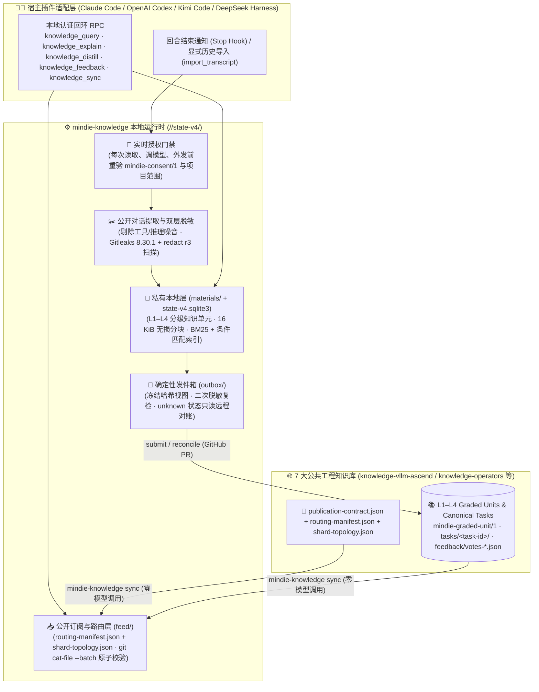

<p align="center">
  
</p>

<h1 align="center">MindIE Knowledge</h1>

<p align="center">
  <strong>让 AI Coding Agent 拥有可验证的领域记忆——L1–L4 分级知识单元、分层分片路由、本地秒级 BM25 条件检索、双层隐私脱敏与社区经验自进化引擎</strong><br>
  <sub>Part of <a href="https://github.com/mindie-agent/mindie-agent">MindIE Agent</a> · Python 包名 <code>mindie-knowledge</code>（模块 <code>mindie_knowledge</code>）</sub>
</p>

<p align="center">
  <a href="https://github.com/mindie-agent/mindie-agent"></a>
  <a href="pyproject.toml"></a>
  <a href="https://github.com/mindie-agent/knowledge-vllm-ascend"></a>
  <a href="mindie_knowledge/redact.py"></a>
  <a href="LICENSE"></a>
  <a href="LICENSE-CORPUS"></a>
</p>

<p align="center">
  <strong>中文</strong> · <a href="README.en.md">English</a> · <a href="#-一句话安装与接入">⚡ 一句话安装</a> · <a href="#-它解决什么问题">✨ 核心价值</a> · <a href="#-官方公共领域知识库生态">🌐 7 大领域知识库</a> · <a href="#️-架构与双向经验飞轮">🏗️ 架构全景</a> · <a href="#-一个脱敏任务知识包长什么样">📦 知识包示例</a> · <a href="#️-命令行与-rpc-接口速查">🛠️ CLI 与接口</a> · <a href="docs/README.md">📚 文档中心</a>
</p>

---

## ⚡ 一句话安装与接入

### 方式一：在日常 AI 编程客户端中一键启用（最推荐 ✨）

`mindie-knowledge` 是 [MindIE Agent](https://github.com/mindie-agent/mindie-agent) 的核心知识运行时。你不需要手动配置守护进程或数据库——直接打开 **Claude Code**、**OpenAI Codex CLI**、**Kimi Code** 或 **DeepSeek Harness（`mindie-agent-dsh`）**，发送下面这句话给你的 Agent：

```text
帮我安装一下这个 https://github.com/mindie-agent/mindie-agent
```

Agent 会自动安装对应的宿主插件（`mindie-agent-cc`、`mindie-agent-codex`、`mindie-agent-kimi` 或 `mindie-agent-dsh`）、拉取固定版本的 `mindie-knowledge` 运行时，并在后台同步 [`knowledge-vllm-ascend`](https://github.com/mindie-agent/knowledge-vllm-ascend)、[`knowledge-operators`](https://github.com/mindie-agent/knowledge-operators) 等官方公共工程知识库。

<details>
<summary>🤖 <b>AI Agent 自动安装与配置指南（当用户让你安装本组件或 MindIE Agent 时请按此执行）</b></summary>

> **给 AI Agent 的说明**：
> 1. **如果用户希望在 Claude Code / Codex / Kimi Code / DeepSeek Harness (`mindie-agent-dsh`) 中使用完整能力**：
>    请直接读取主仓库主页 [`https://github.com/mindie-agent/mindie-agent`](https://github.com/mindie-agent/mindie-agent) 中的自动安装引导，识别你所在的宿主环境并执行对应的插件安装命令。插件会自动管理 `mindie-knowledge` 的虚拟环境、服务生命周期与本地检索索引。
> 2. **如果用户希望在独立开发环境或 CI 中单独安装 `mindie-knowledge` Python 包**：
>    确认环境具备 Python 3.11+ 与 Git，然后执行：
>    ```bash
>    # 从当前仓库安装运行时包
>    python3 -m pip install -e .
>
>    # 若需运行测试套件，安装 test 依赖
>    python3 -m pip install -e '.[test]'
>    ```
> 3. **安装后常用自检与操作命令**：
>    ```bash
>    # 查看当前脱敏规则集版本（当前为 r3）
>    python3 -m mindie_knowledge.redact --profile
>
>    # 同步公开知识源（零大模型调用，社区共享关闭时同样可用）
>    mindie-knowledge sync --config domain.json
>
>    # 查看本地知识服务与索引状态
>    mindie-knowledge status --config domain.json
>    mindie-knowledge sharing-status --config domain.json
>    ```

</details>

---

## ✨ 它解决什么问题？

在昇腾（Ascend NPU）推理开发（如 `vLLM-Ascend` 算子适配、CANN 图编译、HCCL 多卡通信排障）中，工程师与 AI Agent 经常遇到三个核心矛盾：

1. **通用大模型缺乏垂直领域实战记忆**：每次新开会话都要重新排查相同的环境变量、算子签名和精度对齐套路；
2. **传统“LLM 自动总结经验”会丢细节甚至编造结论**：一旦让大模型改写排障记录，最关键的报错栈、命令参数和失败对照实验就会被模糊掉；
3. **企业与个人开发者高度关注隐私安全**：原始对话里有内网 IP、SSH 登录串、个人目录路径和 Token，绝不能未经严格脱敏就直接外发。

**`mindie-knowledge` 用一套干净的确定性机制解决了这三件事：**

| 核心能力 | 它是怎么工作的（说人话版） |
| --- | --- |
| **📐 L1–L4 分级知识单元架构（`mindie-graded-unit/1`）** | 将领域知识结构化划分为四级单元：**`L1 canonical-fact`**（架构与硬件/框架权威事实）、**`L2 sop`**（标准化排障与验证操作规程）、**`L3 workflow`**（多阶段开发与调优工作流，支持 Hermes 收敛）与 **`L4 optimization-pattern`**（带实测收益对比与去偏探索的优化模式），支持父子规则继承与精确条件匹配（`applicability`）。 |
| **🧭 分层分片路由与条件匹配检索** | 通过 `routing-manifest.json` 与 `shard-topology.json` 实现多领域、多子拓扑的分层分片路由（Hierarchical Shard Routing），结合 `applicability` 适用条件过滤与本地 **BM25 + 标识符精确匹配**，毫秒级定位匹配当前 SoC、框架版本与场景的知识单元，**零大模型开销、零网络请求**。 |
| **📖 先看目录，再按需读原文** | 同时支持 `mindie-graded-unit/1` 分级知识单元与 `state-v4` 任务知识包（轻量级 `index.md` 导航清单 + 16 KiB 无损原文分块 `blocks/<block_id>.md`）。Agent 先浏览摘要与适用条件，只对真正匹配的单元或分块点开精读，省 Token 且不漏细节。 |
| **⚗️ 证据驱动经验提炼（`knowledge_distill`）与同步（`knowledge_sync`）** | 支持从经过实机验证的排障/调优证据中结构化提炼（`knowledge_distill`）新的分级知识单元，并通过 `knowledge_sync` 按需增量同步最新上游知识源，由 `publication_check` 在 CI 侧流式校验 Schema、分片拓扑与隐私合规。 |
| **🛡️ 双层闭锁式隐私脱敏** | 社区共享**默认关闭（Opt-in）**。即使开启后，也只提取用户输入与助手可见回复（剔除工具调用噪音与隐藏推理链），并在入库与外发前先后经过 **Gitleaks + `mindie_knowledge.redact`（`r3`）** 双重确定性扫描，绝不用大模型篡改技术正文。 |
| **📮 确定性发件箱与只读对账** | 自动将完成索引的本地草稿、分级知识单元与有用性投票打包为 `mindie-contribution/1` 批次提交 GitHub PR。遇到网络超时或结果未知（`unknown`）时，仅做只读远程 PR 对账，**绝不盲目重放写操作或重复调用付费模型**。 |
| **👍 独立版本化有用性反馈** | Agent 在实机验证某条知识后，可针对当时读到的精确修订号（`@<observed-revision>`）投 `up` 或 `down`，帮助社区识别真正管用的排障方案，同时绝不把投票数当成盲目信任的权威认证。 |

---

## 🌐 官方公共领域知识库生态

`mindie-knowledge` 驱动着 `@mindie-agent` 组织下的 **7 个官方公共领域知识库**，每个仓库均通过 `routing-manifest.json`、`shard-topology.json` 与 `publication_check` 门禁维护结构化的 `L1–L4` 分级知识单元（`mindie-graded-unit/1`）：

| 知识库仓库 | 领域标识（`domain`） | 覆盖范围与核心内容 |
| --- | --- | --- |
| **[`knowledge-vllm-ascend`](https://github.com/mindie-agent/knowledge-vllm-ascend)** | `vllm-ascend` | `vLLM-Ascend` 模型 0day 适配（DeepSeek / Qwen / Kimi 等）、ACLGraph/TorchAir 图编译、MoE EP/MC2、量化与精度/性能调优 |
| **[`knowledge-operators`](https://github.com/mindie-agent/knowledge-operators)** | `operators` | 昇腾 910B / 910C (A3) / 950 (A5) 算子工程：`AscendC`、`Triton-Ascend`、`CATLASS`/`TileLang`、FIA/FlashMLA 与融合算子调优 |
| **[`knowledge-infer-core`](https://github.com/mindie-agent/knowledge-infer-core)** | `infer-core` | 推理引擎核心调度、Continuous Batching、PagedAttention / KV Cache 管理、Speculative Decoding 与前缀缓存 |
| **[`knowledge-infer-distributed`](https://github.com/mindie-agent/knowledge-infer-distributed)** | `infer-distributed` | 多机多卡分布式推理、TP/PP/DP/EP 并行策略、PD 分离架构、HCCL/RoCE 通信排障与集合通信优化 |
| **[`knowledge-infer-observability`](https://github.com/mindie-agent/knowledge-infer-observability)** | `infer-observability` | 推理可观测性与性能分析：`msprof` Profiling 采集解析、Host-Device 瓶颈归因、显存拆解与 Roofline 建模 |
| **[`knowledge-infer-ops-compat`](https://github.com/mindie-agent/knowledge-infer-ops-compat)** | `infer-ops-compat` | CANN / 驱动 / 固件 / PyTorch (`torch_npu`) 跨版本兼容性矩阵、昇腾环境配置、容器镜像与编译工具链排障 |
| **[`knowledge-agent-engineering`](https://github.com/mindie-agent/knowledge-agent-engineering)** | `agent-engineering` | AI Coding Agent 工程实践、Harness 插件边界、评测基准构建、上下文分层披露与知识自进化工作流 |

---

## 🏗️ 架构与双向经验飞轮

### 1. 双层知识闭环与脱敏流水线



### 2. 三层本地存储设计（为什么既快又稳？）

`mindie-knowledge` 将本地状态清晰地存放在 `<root>/<domain>/state-v4/` 下，各司其职：

| 存储层次 | 存放内容 | 工程设计考量 |
| --- | --- | --- |
| **公开订阅层 (`feed/`)** | 浅层 Git 缓存 + 已校验通过的 `tasks/<task-id>/` 只读视图 | 追踪上游内容仓库的不可变提交，通过单个持久 `git cat-file --batch` 进程逐个文件流式校验，全部通过后才原子切换，失败时老数据完好无损。 |
| **本地材料与索引层 (`materials/` + `state-v4.sqlite3`)** | 原始 Markdown 分块正文 + SQLite 元数据/游标/账本 + ReMe 词频缓存 | **正文字节永远以普通 Markdown 文件为准**，SQLite 只存轻量指针、游标和模型调用账本；万一检索缓存损坏，随时可从 Markdown 原文无损重建。 |
| **发件箱与共享层 (`outbox/`)** | 冻结的待发送知识包视图 + 社区发布账本 | 仅在用户开启社区共享时激活；模型返回结果先落盘再应用，外部写入结果不确定（`unknown`）时持久保留现场，等待只读对账确认。 |

---

## 📦 一个脱敏任务知识包长什么样？

无论是本地采集还是同步自 [`knowledge-vllm-ascend`](https://github.com/mindie-agent/knowledge-vllm-ascend)，每个任务知识包都遵循统一的 `tasks/<64-hex-task-id>/` 目录结构：

```text
tasks/c3f998fdce9eecfbf1171624d6f791d4fc8e4e1b2bf7636f59dfa05e37327815/
├── index.md                                                                 # 任务导航清单 (mindie-material-task/1)
└── blocks/
    └── 89bafb72f7ba1dc374e81c1f4c302ab4f20d7fbb1edc0afe568356190bc89f99.md  # 无损脱敏原文分块 (mindie-material-block/1)
```

- **`index.md`（检索导航清单）**：内嵌 `mindie-entry/3` 头部，记录适用条件（如 `torch_npu_version: 2.10.0.post2`）、任务总体导航摘要，以及每个分块的 `block_id`、`sha256` 校验和与分块摘要。
- **`blocks/<block_id>.md`（不可变正文分块）**：保留经 Gitleaks 与 `redact`（`r3`）清洗后的原始公开对话或实机验证步骤（例如完整的 `torch_npu.npu_rms_norm` 精度对比代码与误差输出；敏感路径会被替换为 `<redacted:user-path:6873afcd2105>` 形式的闭环占位符）。

---

## 🛠️ 命令行与 RPC 接口速查

### 1. 日常服务与诊断 CLI（`mindie-knowledge`）

```bash
# 在前台启动领域知识服务（持有 consumer.lock 并提供本地认证回环 RPC）
mindie-knowledge serve --config domain.json

# 查看服务运行状态、本地语料统计与模型调用/Token 计数
mindie-knowledge status --config domain.json

# 查看社区共享开关状态、最近采集记录、覆盖缺口、投票与发件箱队列
mindie-knowledge sharing-status --config domain.json

# 导出本地故障诊断快照（可加 --session <session-id> 过滤单个会话）
mindie-knowledge diagnostic-status --config domain.json

# 执行一次独立的公开知识库同步（零模型调用；加 --resume 可立即跳过网络退避重试）
mindie-knowledge sync --config domain.json
mindie-knowledge sync --config domain.json --resume

# 接收宿主 Stop Hook 事件（从 stdin 读取 JSON）并异步唤醒后台处理
mindie-knowledge hook --config domain.json

# 安全停止当前运行中的领域知识服务
mindie-knowledge stop --config domain.json
```

### 2. 社区贡献批次维护命令（零模型调用）

当你需要排查或手动处理某个外发批次（`<batch-id>`）时：

```bash
# 只读查看指定批次在本地发件箱与社区账本中的详细状态
mindie-knowledge contribution-inspect --config domain.json --batch <batch-id>

# 对处于 unknown（结果未知）或待定状态的批次执行一次只读远程 PR 对账
mindie-knowledge contribution-reconcile --config domain.json --batch <batch-id>

# 显式重发已确认为 failed 或 rejected 的冻结批次（对 unknown 状态拒绝盲目重放）
mindie-knowledge contribution-retry --config domain.json --batch <batch-id>

# 清理已确认发布批次的私有暂存目录（保留本地草稿直至同步回公共源）
mindie-knowledge contribution-compact --config domain.json --batch <batch-id>
```

### 3. 独立工具模块入口（发布、CI 校验与脱敏扫描）

```bash
# 贡献者侧直接提交或只读对账单个批次（输出单行 JSON 回执）
python3 -m mindie_knowledge.community submit --settings community.json --state-dir ~/.mindie/community --batch batch.json
python3 -m mindie_knowledge.community reconcile --settings community.json --state-dir ~/.mindie/community --batch-id <batch-id>

# 内容仓库 CI 校验器：流式校验不可变 Git 提交中的任务包、反馈、契约哈希与隐私安全
python3 -I -m mindie_knowledge.publication_check \
    --repo <checkout> --revision <head-40-sha> \
    --domain vllm-ascend --base-revision <base-40-sha> \
    --contract-sha256 <expected-contract-sha256>

# 确定性隐私脱敏扫描器（--check 模式下发现敏感信息返回非零退出码）
python3 -m mindie_knowledge.redact --check README.md README.en.md CONTRIBUTING.md CONTRIBUTING.en.md docs mindie_knowledge/skills
python3 -m mindie_knowledge.redact --profile
```

### 4. 给宿主插件调用的本地回环接口

各客户端插件（Claude Code / Codex / Kimi Code / DeepSeek Harness `mindie-agent-dsh`）将原生工具调用转发至 `mindie-knowledge` 的本地认证回环接口：

| 接口名称 | 作用说明 |
| --- | --- |
| **`knowledge_query(query, limit?, conditions?, continuation?)`** | 基于 `routing-manifest.json` + `shard-topology.json` 分层路由与 `applicability` 条件过滤，搜索当前可见 `L1–L4` 分级知识单元（`mindie-graded-unit/1`）与任务分块并按引用链聚合（`limit` 1–20），返回可读引用 `ref`、`task_ref`、`feedback_ref`、原文摘录及翻页令牌 `related_next`。 |
| **`knowledge_explain(ref)`** | 按精确引用展开 `L1–L4` 分级知识单元（含继承的父级规则与适用条件）或任务导航大纲（`mindie://DOMAIN/TASK`）及无损分块正文（`mindie://DOMAIN/TASK/blocks/<block-id>@<file-sha256>`）。 |
| **`knowledge_distill(...)`** | 从经过实机验证的排障/调优证据中结构化提炼新的分级知识单元（`L1 canonical-fact` / `L2 sop` / `L3 workflow` / `L4 optimization-pattern`），通过脱敏与 Schema 校验后进入本地复用与社区准入队列。 |
| **`knowledge_feedback(ref, rating, reason?)`** | 针对精确观测修订 `mindie://DOMAIN/<task-id>@<observed-revision>` 记录 `up` / `down` 评价及可选单行原因（最多 1000 字符）。 |
| **`knowledge_sync(...)`** | 按需执行一次零大模型调用的上游公开知识库增量同步，通过 `git cat-file --batch` 流式校验后原子切换本地可见视图。 |
| **`mindie_knowledge.loop.history_import.import_transcript`** | 显式导入用户指定的历史会话快照，复用与实时采集完全一致的脱敏、分块与准入管线。 |
| **`mindie_knowledge.releases`** | 解析插件正式版资产 `mindie-plugin-release.json` 与 `mindie-harness-compatibility/1`，供更新器挑选兼容当前宿主版本的最高正式版。 |

---

## 📚 文档中心

[`docs/`](docs/README.md) 目录提供了完整的中英双语架构与实现说明（全部重写为清晰易读的工程指南）：

| 文档主题 | 中文文档 | English | 一句话看懂它讲什么 |
| --- | --- | --- | --- |
| **文档总览索引** | [docs/README.md](docs/README.md) | [docs/README.en.md](docs/README.en.md) | 全部架构、数据流与跨平台生命周期文档导览 |
| **领域知识闭环总览** | [mindie-loop.zh.md](docs/mindie-loop.zh.md) | [mindie-loop.md](docs/mindie-loop.md) | 从授权门禁、对话采集、BM25 检索、引用分组到同步与外发的端到端运转机制 |
| **公开对话采集与增量索引** | [public-transcript-capture.zh.md](docs/public-transcript-capture.zh.md) | [public-transcript-capture.md](docs/public-transcript-capture.md) | 如何只提取公开可见消息、做双层脱敏并用小模型增量生成分块导航 |
| **显式历史会话导入** | [history-import.zh.md](docs/history-import.zh.md) | [history-import.md](docs/history-import.md) | 如何把以前跑过的有价值会话安全导入知识闭环，且支持断点续导 |
| **社区共享与发件箱对账** | [community-sharing.zh.md](docs/community-sharing.zh.md) | [community-sharing.md](docs/community-sharing.md) | 贡献者端如何隔离凭据、幂等提交 PR 以及在网络中断后只读对账 |
| **仓库审核 Bot 规范** | [repository-bot-contract.zh.md](docs/repository-bot-contract.zh.md) | [repository-bot-contract.md](docs/repository-bot-contract.md) | `mindie-content-review/2` 机器人如何自动审核纯内容 PR、做有限脱敏修正与处理撤下 |
| **版本兼容与跨平台文件锁** | [release-compatibility.zh.md](docs/release-compatibility.zh.md) | [release-compatibility.md](docs/release-compatibility.md) | 插件如何挑选兼容当前宿主的正式版，以及 POSIX/Windows 共享与排他文件锁 |
| **服务与子进程生命周期** | [service-process-lifetime.zh.md](docs/service-process-lifetime.zh.md) | [service-process-lifetime.md](docs/service-process-lifetime.md) | Windows 计划任务、Linux systemd 254+ 与 macOS 管道守卫如何管理后台服务与子进程寿命 |
| **摘要进程与临时目录回收** | [summary-process-ownership.zh.md](docs/summary-process-ownership.zh.md) | [summary-process-ownership.md](docs/summary-process-ownership.md) | 为什么先落盘结果、再关进程树、最后删临时目录，彻底消除并发清理竞态 |
| **Windows 知识服务宿主** | [windows-service-host.zh.md](docs/windows-service-host.zh.md) | [windows-service-host.md](docs/windows-service-host.md) | 原生 Windows 下如何用 Task Scheduler + DPAPI 让知识服务跨越短 Hook 存活 |
| **Windows 进程树强归属** | [windows-process-ownership.zh.md](docs/windows-process-ownership.zh.md) | [windows-process-ownership.md](docs/windows-process-ownership.md) | `spawn_owned` 挂起创建 + `KILL_ON_JOB_CLOSE` Job Object 如何杜绝孤儿进程与管道泄漏 |
| **框架稳定性与验证边界** | [framework-stability.zh.md](docs/framework-stability.zh.md) | [framework-stability.md](docs/framework-stability.md) | 生产解析器夹具、ReMe 可重建索引、Windows 原子重命名与测试验收边界 |

---

## 🧪 本地开发与测试

```bash
# 1. 运行完整单元测试与集成测试套件（默认使用仓库内提交的 tests/fixtures/production-parsers）
MINDIE_FRAMEWORK_SOURCE=tests/fixtures/production-parsers python3 -m pytest -q tests

# 2. 扫描公开文档与内置技能文件，确保零敏感数据命中
python3 -m mindie_knowledge.redact --check README.md README.en.md CONTRIBUTING.md CONTRIBUTING.en.md docs mindie_knowledge/skills
```

参与开发或提交 PR 前，请参阅 [贡献指南（CONTRIBUTING.md）](CONTRIBUTING.md)。

---

## 📄 许可证

- 源代码、脚本与运行时组件采用 [MIT License](LICENSE) 开源。
- 知识语料与文档规范采用 [Creative Commons Attribution 4.0 International (CC-BY-4.0)](LICENSE-CORPUS) 开源。
