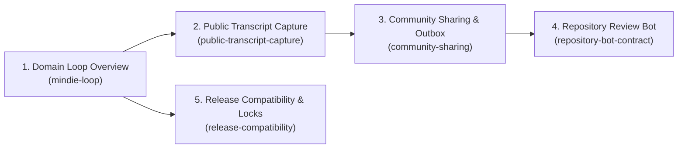

# MindIE Knowledge Documentation Center

[中文](README.md) | **English** · [Back to Repository Home](../README.en.md)

Welcome to the `mindie-knowledge` (`mindie-agent/knowledge`) documentation center! Every living specification here is written in clear engineering prose explaining **how the graded domain knowledge loop works end to end**, **how double fail-closed privacy redaction prevents leaks**, and **how release compatibility, runtime inventories, and OS file locks coordinate safely**.

---

## 🗺️ Reading Roadmap

---

## 1. Core Data Pipeline & Community Flywheel (Living Specifications)

These guides walk through how a troubleshooting or optimization session becomes searchable graded units and lossless Markdown blocks, how hierarchical shard routing and local BM25 retrieval work with zero model cost, and how opt-in community contributions flow safely to the public corpus:

| English Guide | 中文文档 | What You Will Learn |
| --- | --- | --- |
| **[MindIE Domain Loop Overview](mindie-loop.md)** | **[领域知识闭环总览](mindie-loop.zh.md)** | **Start Here**: The end-to-end architecture connecting consent gates, two-layer storage, transcript capture, hierarchical routing + BM25 retrieval, feedback votes, outbox reconciliation, and public feed sync. |
| **[Public Transcript Capture & Indexing](public-transcript-capture.md)** | **[公开对话采集与增量索引](public-transcript-capture.zh.md)** | How visible user/assistant turns are projected, redacted with Gitleaks + `r4` into lossless 16 KiB blocks, admitted within a single monotonic `Stop` deadline, and indexed incrementally. |
| **[Community Sharing & Outbox](community-sharing.md)** | **[社区贡献与外发规范](community-sharing.zh.md)** | How `mindie_knowledge.community` isolates GitHub credentials, submits idempotent `mindie-contribution/1` batches, and reconciles uncertain network writes via read-only checks. |
| **[Repository Review Bot Contract](repository-bot-contract.md)** | **[仓库审核 Bot 规范](repository-bot-contract.zh.md)** | The `mindie-content-review/2` specification: how the maintainer's review bot combines zero-trust CI validation, bounded redaction edits, auto-merge for pure content PRs, and package withdrawals. |

---

## 2. Release Compatibility, Runtime Inventories & File Locks

| English Guide | 中文文档 | What You Will Learn |
| --- | --- | --- |
| **[Release Compatibility, Component Updates & File Locks](release-compatibility.md)** | **[版本兼容、组件更新与跨平台文件锁](release-compatibility.zh.md)** | How `mindie-plugin-release.json` selects compatible plugin releases, how v1/v2 `runtime_inventory` and `component_runtime` discover and build side-by-side `uv` runtimes (including `mindie-harness` substrate support), and how `locks.py` provides shared/exclusive OS file locking. |
| **[Archived Historical Specifications](archive/README.md)** | **[历史过渡方案归档索引](archive/README.md)** | Historical process-supervision, Windows service-host transition notes, and explicit transcript-import notes preserved for design provenance. |

---

## 3. Release Notes

| English Notes | 中文说明 | Highlights |
| --- | --- | --- |
| **[`0.13.25` Release Notes](releases/knowledge-0.13.25.en.md)** | **[`0.13.25` 发布说明](releases/knowledge-0.13.25.md)** | Out-of-the-box read-only service startup with `capture_mode="disabled"`, rollback-safe pre-persist distillation redaction (`graded:related-meta:<hash>`), and dual-layer Windows `pyvenv.cfg` PE GUI validation. |
| [`0.13.24` Release Notes](releases/knowledge-0.13.24.en.md) | [`0.13.24` 发布说明](releases/knowledge-0.13.24.md) | First-class `local-only` consent tier, separated capture vs. publication authority, pure anonymous HTTPS public feed sync, and `r4` password redaction hardening. |
| [`0.13.23` Release Notes](releases/knowledge-0.13.23.en.md) | [`0.13.23` 发布说明](releases/knowledge-0.13.23.md) | Pure knowledge domain convergence, backward-compatible `mindie-harness` RSI shims, `< 1ms` PEP 562 lazy top-level imports, and handoff race hardening. |
| [`0.13.22` Release Notes](releases/knowledge-0.13.22.en.md) | [`0.13.22` 发布说明](releases/knowledge-0.13.22.md) | Shared storage lifecycle (`.inuse` leases and two-phase `.trash-*` retirement), automatic same-volume `uv` cache selection, Windows short directory keys, and silent cross-harness reclamation. |
