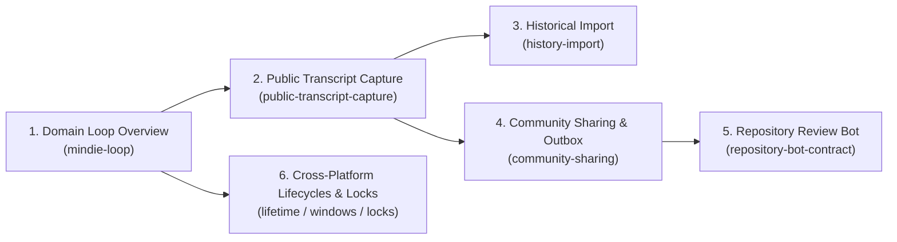

# MindIE Knowledge Documentation Center

[中文](README.md) | **English** · [Back to Repository Home](../README.en.md)

Welcome to the `mindie-knowledge` (`mindie-agent/knowledge`) documentation center! Every guide in this directory is written in clear, straightforward engineering prose to explain **how the domain knowledge loop works end to end**, **how double fail-closed privacy redaction prevents leaks**, and **how background services and subprocess trees are managed safely across macOS, Linux, and Windows**.

---

## 🗺️ Reading Roadmap

---

## 1. Core Data Pipeline & Community Flywheel

These guides walk through how a real troubleshooting session becomes searchable Markdown blocks, how local BM25 retrieval works with zero model cost, and how opt-in community contributions flow safely to the public corpus:

| English Guide | 中文文档 | What You Will Learn |
| --- | --- | --- |
| **[MindIE Domain Loop Overview](mindie-loop.md)** | **[领域知识闭环总览](mindie-loop.zh.md)** | **Start Here**: The end-to-end architecture connecting consent gates, two-layer storage, transcript capture, BM25 citation grouping, feedback votes, outbox reconciliation, and public feed sync. |
| **[Public Transcript Capture & Indexing](public-transcript-capture.md)** | **[公开对话采集与增量索引](public-transcript-capture.zh.md)** | How visible user/assistant turns are projected, redacted with Gitleaks + `r3` into lossless 16 KiB blocks, and indexed incrementally by a small native worker. |
| **[Explicit Historical Transcript Import](history-import.md)** | **[显式历史会话导入](history-import.zh.md)** | How `import_transcript` safely brings selected past sessions into the knowledge loop with prefix verification, resumable intake, and remote continuation. |
| **[Community Sharing & Outbox](community-sharing.md)** | **[社区贡献与外发规范](community-sharing.zh.md)** | How `mindie_knowledge.community` isolates GitHub credentials, submits idempotent `mindie-contribution/1` batches, and reconciles uncertain network writes via read-only checks. |
| **[Repository Review Bot Contract](repository-bot-contract.md)** | **[仓库审核 Bot 规范](repository-bot-contract.zh.md)** | The `mindie-content-review/2` specification: how the maintainer's review bot combines zero-trust CI validation, bounded redaction edits, auto-merge for pure content PRs, and package withdrawals. |

---

## 2. Release Compatibility, Cross-Platform Services & Process Lifecycles

These guides explain how `mindie-knowledge` coordinates file locks, background services, and summary subprocess trees across macOS, Linux/WSL, and native Windows—without blocking foreground sessions or leaving orphan processes behind:

| English Guide | 中文文档 | What You Will Learn |
| --- | --- | --- |
| **[Release Compatibility, Component Updates & File Locks](release-compatibility.md)** | **[版本兼容、组件更新与跨平台文件锁](release-compatibility.zh.md)** | How `mindie-plugin-release.json` selects compatible plugin releases, how `component_runtime` and `runtime_inventory` discover and build side-by-side `uv` runtimes across the 8 official components, and how `locks.py` provides shared/exclusive OS file locking. |
| **[Service & Attempt Process Lifetime](service-process-lifetime.md)** | **[服务与单次操作生命周期](service-process-lifetime.zh.md)** | How Windows Task Scheduler, Linux `systemd` (254+), and macOS `owner-pipe` watchers contain background services and per-attempt subprocess trees. |
| **[Summary Process & Scratch Ownership](summary-process-ownership.md)** | **[摘要进程与临时目录回收](summary-process-ownership.zh.md)** | The `MINDIE_SUMMARY_SCRATCH` contract and the strict 4-step teardown order: persist result first, terminate process tree second, drain pipes third, delete temporary directory last. |
| **[Windows Knowledge Service Host](windows-service-host.md)** | **[Windows 知识服务宿主](windows-service-host.zh.md)** | How native Windows uses Task Scheduler COM APIs + one-use DPAPI context transfer so the knowledge service outlives short-lived Hook processes. |
| **[Windows Process Tree Ownership](windows-process-ownership.md)** | **[Windows 进程树强归属](windows-process-ownership.zh.md)** | How `spawn_owned` combines `CREATE_SUSPENDED` with a `KILL_ON_JOB_CLOSE` Job Object to prevent grandchild process escape and pipe hangs on Windows. |
| **[Framework Stability & Verification](framework-stability.md)** | **[框架稳定性与验证边界](framework-stability.zh.md)** | Pinned parser fixtures, rebuildable ReMe indexes, Windows delete-sharing atomic config renames, and the boundary between unit tests and live host acceptance. |
