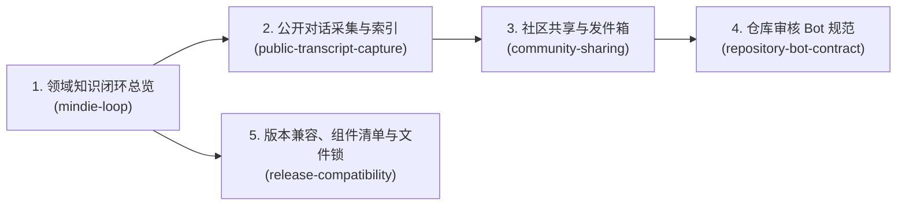

# MindIE Knowledge 技术文档中心

**中文** | [English](README.en.md) · [返回仓库首页](../README.md)

欢迎来到 `mindie-knowledge`（`mindie-agent/knowledge`）文档中心！这里的活跃规范采用清晰、直观的工程语言编写，专注说明**分级领域知识闭环是如何运转的**、**双层隐私脱敏是如何做到闭锁防漏的**，以及**组件版本兼容与文件锁契约是如何协同的**。

---

## 🗺️ 阅读路线图

---

## 1. 核心数据流与社区飞轮（Living Specifications）

这一组文档解释一次真实的排障或调优会话如何转化为可检索的分级知识单元与无损分块、如何在本地通过分层路由与 BM25 毫秒级召回，以及如何在用户显式授权后安全贡献回公共知识库：

| 中文文档 | English | 核心内容导读 |
| --- | --- | --- |
| **[领域知识闭环总览](mindie-loop.zh.md)** | **[MindIE Domain Loop](mindie-loop.md)** | **必读总纲**：串联授权门禁、双层存储、公开对话采集、分层路由与 BM25 检索、有用性反馈、发件箱对账与公共源同步的完整闭环。 |
| **[公开对话采集与增量索引](public-transcript-capture.zh.md)** | **[Public Transcript Capture](public-transcript-capture.md)** | 如何从宿主 Transcript 中只提取公开可见消息、通过 Gitleaks + `r3` 脱敏切分为 16 KiB 无损分块，并按单调外层预算安全完成 `Stop` 准入与增量导航摘要。 |
| **[社区共享与发件箱对账](community-sharing.zh.md)** | **[Community Sharing](community-sharing.md)** | 贡献者侧 `mindie_knowledge.community` 如何隔离 GitHub 凭据、幂等提交 `mindie-contribution/1` 批次，以及在网络超时后通过只读查询对账。 |
| **[仓库审核 Bot 规范](repository-bot-contract.zh.md)** | **[Repository Bot Contract](repository-bot-contract.md)** | `mindie-content-review/2` 规范：维护者侧审核应用如何结合零信任 CI 检查、做有限脱敏修正、自动合入纯内容 PR 以及处理撤下请求。 |

---

## 2. 版本兼容、组件运行时清单与文件锁

| 中文文档 | English | 核心内容导读 |
| --- | --- | --- |
| **[版本兼容、组件更新与跨平台文件锁](release-compatibility.zh.md)** | **[Release Compatibility & Locks](release-compatibility.md)** | `mindie-plugin-release.json` 宿主版本区间选择、v1/v2 组件清单（含 `mindie-harness` 共享宿主底座桥接）的独立 GitHub Release 发现与并排 `uv` 运行时构建，以及 POSIX/Windows 文件锁契约。 |
| **[历史过渡方案归档索引](archive/README.md)** | **[Archived Historical Specs](archive/README.md)** | 早期宿主进程监管、Windows 计划任务过渡方案与显式历史导入的溯源归档（仅供历史参考，不作为当前门禁）。 |
