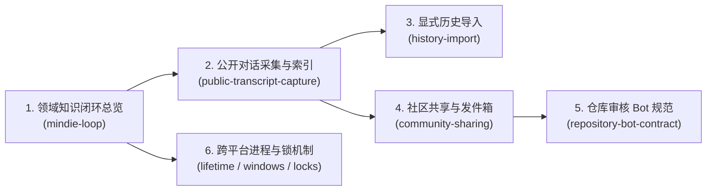

# MindIE Knowledge 技术文档中心

**中文** | [English](README.en.md) · [返回仓库首页](../README.md)

欢迎来到 `mindie-knowledge`（`mindie-agent/knowledge`）文档中心！这里的所有文档均已采用清晰、直观的工程语言编写，帮助你快速理解**领域知识闭环是如何运转的**、**隐私脱敏是如何做到闭锁防漏的**，以及**跨平台后台服务与子进程是如何安全管理的**。

---

## 🗺️ 阅读路线图

---

## 1. 核心数据流与社区飞轮

这一组文档解释一次真实的调试会话是如何变成可检索分块、如何在本地通过 BM25 秒级召回，以及如何在用户开启共享后安全地贡献回公共知识库的：

| 中文文档 | English | 核心内容导读 |
| --- | --- | --- |
| **[领域知识闭环总览](mindie-loop.zh.md)** | **[MindIE Domain Loop](mindie-loop.md)** | **必读总纲**：串联授权门禁、双层存储、公开对话采集、BM25 引用分组检索、有用性反馈、发件箱对账与公共源同步的完整闭环。 |
| **[公开对话采集与增量索引](public-transcript-capture.zh.md)** | **[Public Transcript Capture](public-transcript-capture.md)** | 如何从宿主 Transcript 中只提取公开可见消息、通过 Gitleaks + `r3` 脱敏切分为 16 KiB 无损分块，并调用小模型增量生成导航摘要。 |
| **[显式历史会话导入](history-import.zh.md)** | **[Historical Transcript Import](history-import.md)** | 当你想把以前跑过的某次排障会话导入知识库时，`import_transcript` 如何做前缀校验、断点续导以及与远端修订衔接。 |
| **[社区共享与发件箱对账](community-sharing.zh.md)** | **[Community Sharing](community-sharing.md)** | 贡献者侧 `mindie_knowledge.community` 如何隔离 GitHub 凭据、幂等提交 `mindie-contribution/1` 批次，以及在网络超时后通过只读查询对账。 |
| **[仓库审核 Bot 规范](repository-bot-contract.zh.md)** | **[Repository Bot Contract](repository-bot-contract.md)** | `mindie-content-review/2` 规范：维护者侧审核 Bot 如何结合零信任 CI 检查、做有限脱敏修正、自动合入纯内容 PR 以及处理撤下请求。 |

---

## 2. 版本兼容、跨平台服务与进程生命周期

这一组文档解释 `mindie-knowledge` 如何在 macOS、Linux/WSL 和原生 Windows 下管理文件锁、后台服务和摘要子进程树，确保既不阻塞前台会话，也不产生孤儿进程或残留临时文件：

| 中文文档 | English | 核心内容导读 |
| --- | --- | --- |
| **[版本兼容、组件更新与跨平台文件锁](release-compatibility.zh.md)** | **[Release Compatibility & Locks](release-compatibility.md)** | `mindie-plugin-release.json` 宿主版本区间选择、8 个官方组件的独立 GitHub Release 发现与并排 `uv` 运行时构建（`component_runtime` / `runtime_inventory`），以及 POSIX/Windows 共享/排他文件锁。 |
| **[服务与单次操作生命周期](service-process-lifetime.zh.md)** | **[Service & Attempt Lifetime](service-process-lifetime.md)** | Windows 计划任务、Linux `systemd`（254+）与 macOS `owner-pipe` 如何实现后台服务与模型子进程树的跨平台容器化隔离。 |
| **[摘要进程与临时目录回收](summary-process-ownership.zh.md)** | **[Summary Process Ownership](summary-process-ownership.md)** | `MINDIE_SUMMARY_SCRATCH` 内部契约：为什么必须严格遵循“先持久化结果 -> 再关停进程树 -> 最后删除临时目录”的三步顺序。 |
| **[Windows 知识服务宿主](windows-service-host.zh.md)** | **[Windows Service Host](windows-service-host.md)** | 原生 Windows 下如何用 Task Scheduler COM 接口 + DPAPI 一次性加密上下文，让后台知识服务跨越短生命周期的 Hook 进程安全存活。 |
| **[Windows 进程树强归属](windows-process-ownership.zh.md)** | **[Windows Process Ownership](windows-process-ownership.md)** | `spawn_owned` 如何通过挂起创建（`CREATE_SUSPENDED`）+ `KILL_ON_JOB_CLOSE` Job Object 彻底解决 Windows 孙进程逃逸与管道挂死问题。 |
| **[框架稳定性与验证边界](framework-stability.zh.md)** | **[Framework Stability](framework-stability.md)** | 生产解析器夹具隔离、ReMe 派生索引重建、Windows 允许删除共享（Delete-Sharing）的原子重命名配置读写，以及测试与实机验收的边界。 |
