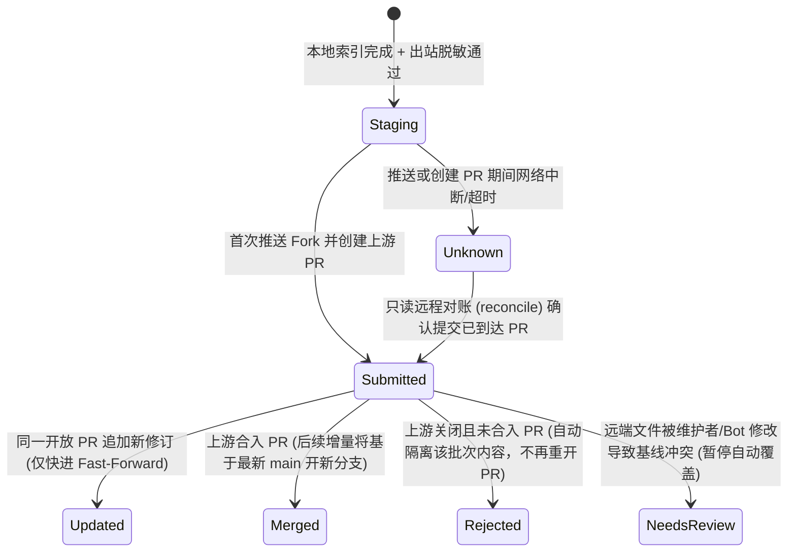

# 社区共享与发件箱对账（Community Sharing & Contributor Outbox）

**中文** | [English](community-sharing.md) · [返回文档中心](README.md)

本文说明 `mindie_knowledge.community` 模块在**贡献者本机侧**是如何工作的：如何安全地隔离 GitHub 凭据、如何把本地已完成索引的知识包与有用性反馈打包成 Pull Request，以及在遇到网络超时或中断时如何通过只读对账安全恢复。

> [!NOTE]
> **职责边界**：本模块仅负责贡献者侧的确定性打包、推送与对账（全程**零大模型调用**）。公共仓库侧的自动审核与合入由维护者部署的外部审核 Bot 执行，详见 [《仓库审核 Bot 规范》](repository-bot-contract.zh.md)。

---

## 1. 凭据安全与实时门禁（绝不落盘 Token）

1. **只存环境变量名，不存 Token 明文**：
   配置文件、回执、日志和 Git 提交中**绝不出现任何凭据明文**。设置文件仅记录存放 Token 的环境变量名称（`token_env`，默认为 `GH_TOKEN`）。当启动 Git 子进程时，仅在该子进程内部通过临时 `credential.helper=!gh auth git-credential` 绑定完成认证。
2. **每次外发前重验权威配置**：
   在执行任何外部写入前，系统都会重新读取私有的绝对路径配置文件（`settings["config_path"]`）与 `mindie-consent/1`，核对启用状态、授权代次（`generation`）、启用时间、目标仓库、分支、Fork、账号及允许的项目根目录（`project_roots`）。任何一项不匹配都会立即闭锁中止。
3. **子进程资源与时限受控**：
   所有外部 Git / `gh` 命令均以纯参数列表（`argv`，不使用 Shell 拼接）启动，绑定进程树回收机制，并设有总事务时限（默认 120 秒）与单次操作步数上限（默认 60 步）。

---

## 2. 批次打包与幂等 PR 演进（`mindie-contribution/1`）

### 双重校验与纯模板 PR 生成
- 每个外发批次遵循 `mindie-contribution/1` Schema，包含完整的 `tasks/<task-id>/index.md`（`mindie-material-task/1` + `mindie-entry/3`）及其引用的 `tasks/<task-id>/blocks/*.md`（`mindie-material-block/1`），以及可选的 `feedback/*.json`（`mindie-feedback/1`）。
- 在真正执行 Git 写入前，`mindie_knowledge.community` 会在信任边界再次校验所有文件的 SHA-256 摘要、路径白名单，并对**文件内容、确定性生成的 PR 标题/正文以及 Commit Message** 全部重跑一次 `mindie_knowledge.redact`（`r3`）隐私扫描。

### 幂等提交与 PR 状态机



- **内容修订号幂等**：幂等键基于**内容修订摘要（Content Revision）**而非事件 ID。同一修订重复提交不会产生重复写操作。
- **尊重远端维护者修改与撤下**：上游仓库（`main`）始终是内容权威，贡献者的 Fork 仅作为推送跳板。
  - 若自己的开放 PR 仍在，新修订仅以 Fast-Forward 方式更新该 PR（绝不强制 `force-push` 覆盖他人提交）；
  - 若远端文件已被维护者或审核 Bot 修改（与本地记录的上次已确认基线不一致），或者该任务已被上游撤下，状态会停留在 `needs_review`（或阻止复活），**绝不会强行覆盖维护者的修改**；
  - 若上游 PR 被关闭且未合入（Closed & Unmerged），该批次被判定为 `rejected`，对应条目会被隔离出后续自动批次，绝不死缠烂打重开新 PR。

---

## 3. 当网络中断导致结果未知（`unknown`）时怎么办？

分布式系统中最危险的错误是：明明请求已经发出去并在远端生效了，仅仅因为本地没收到响应就盲目重放写操作。

`mindie_knowledge.community` 对此采取了严格的分类恢复策略：
- **启动前失败（`unavailable`）**：例如本地缺少 `git` 或 `gh` 可执行文件，子进程根本没跑起来（确认零外部写入），发件箱会按持久化退避周期在环境恢复后自动重交。
- **中途中断或响应丢失（`unknown`）**：一旦外部写操作已经开始但结果不确定，批次立即标记为 `unknown`。后续调度周期每次只执行**有界只读远程对账（`reconcile`）**——通过查询远端 PR 当前 Head 或验证预期 Commit 是否在 PR 的 Git 祖先链上，来确认上次写入是否成功，**绝不盲目重放写操作**。

---

## 4. 命令行与返回回执

```bash
# 提交单个冻结批次
python3 -m mindie_knowledge.community submit \
    --settings community.json --state-dir ~/.mindie/community --batch batch.json

# 对状态未知或待确认的批次执行只读远程对账
python3 -m mindie_knowledge.community reconcile \
    --settings community.json --state-dir ~/.mindie/community --batch-id <batch-id>
```

两条命令均在标准输出打印一行结构化 JSON 回执（包含 `status`、`batch_id`、`revision`、`pr_url`、`head_sha`、`detail` 及已确认文件的 `files` 哈希映射）。

此外，`mindie_knowledge.community.skill_validation` 还提供纯确定性的 Skill 包格式校验函数（检查 `SKILL.md` 结构、`policy.allow_implicit_invocation: false` 与允许路径），供维护者与审核 Bot 验证候选 Skill 提案。
