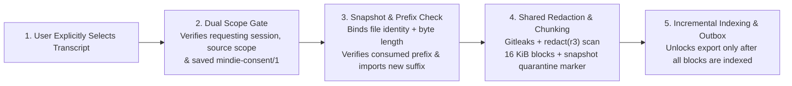

# Explicit Historical Transcript Import

[中文](history-import.zh.md) | **English** · [Back to Documentation Center](README.en.md)

By default, `mindie-knowledge` captures only live sessions that run after you opt into community sharing—**it never automatically scans or backfills older session history**.

However, when you finish a valuable troubleshooting session before enabling sharing and want to bring it into the knowledge loop intentionally, host plugins can call `mindie_knowledge.loop.history_import.import_transcript` to perform an **explicit historical import**.

---

## 1. Historical Import Pipeline

---

## 2. Safety & Zero-Replay Guarantees

### Dual Scope & Consent Verification
- The requesting session must hold a valid manual-entry admission token (`entry_enabled = 1`) and an active `mindie-consent/1` contribution choice.
- **Both the requesting project scope and every imported source session's project scope must be inside the allowed `project_roots`**. The adapter checks this before reading source metadata, and the core re-verifies it before every parser page and commit.
- Because the user explicitly selected the historical file, its file identity and byte length define a fixed snapshot (omitting the live activation-time filter) without granting a new live lease to the historical session.

### Whole-Snapshot Quarantine Until Complete
- A durable intake marker keeps the imported package quarantined from outbound publication until **every page of the selected snapshot** has been redacted and admitted.
- If a malformed record, unexpected EOF, scanner failure, or consent revocation occurs mid-import, the error is reported visibly. **Already committed pages remain safely stored locally for resumption**, and are never misreported as a finished import.

### Prefix Verification & Idempotent Resumption
- Re-running an import on a previously imported transcript verifies the already consumed raw byte prefix and imports **only the new trailing suffix**.
- Repeating an unchanged import creates **zero new blocks and makes zero model calls**. If the previously consumed prefix was altered, the import is rejected without overwriting existing material.

---

## 3. Summary Recovery & Remote Continuation

- **Save Output Before Local Apply**: Just like live capture, the shared summary worker commits returned LangMem outputs and token usage to `SummaryLedger` before applying metadata locally. Local apply interruptions recover without another model call; failed or `unknown` model calls require an explicit retry flag (such as `--retry-summary` in the Codex adapter) rather than automatic background replay.
- **Honest Import Receipts**: The returned receipt reports **local intake status**, **summary indexing status**, and **publication status** separately—never claiming that GitHub PR creation or merge has already occurred.
- **Safe Remote Continuation**: When extending a task that was already published upstream, continuation preserves the confirmed remote blocks/navigation and appends only provably unsent local blocks. If a maintainer or review bot edited the remote file on an open PR (or withdrew the task upstream), the candidate parks as `needs_review` (or blocks resurrection) instead of overwriting remote edits.
