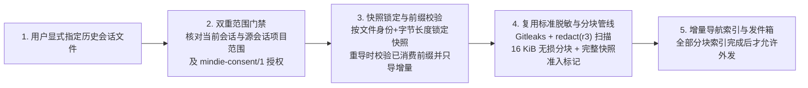

# 显式历史会话导入（Explicit Historical Transcript Import）

**中文** | [English](history-import.md) · [返回文档中心](README.md)

在默认情况下，`mindie-knowledge` 只采集你在开启社区共享之后新产生的活跃任务，**绝不会在后台自动翻阅或导入你以前的历史会话**。

但如果你在开启共享前正好完成了一次非常有价值的昇腾排障会话，希望主动把它沉淀到知识库中，宿主插件可以调用 `mindie_knowledge.loop.history_import.import_transcript` 完成**显式历史导入**。

---

## 1. 显式导入的工作流程

---

## 2. 为什么显式历史导入既安全又不会重复计费？

### 双重授权与范围检查
- 发起导入的当前会话必须持有有效的手动启用准入令牌（`entry_enabled = 1`）且已开启 `mindie-consent/1` 社区贡献。
- **发起方项目与被导入的历史源会话所属项目都必须在允许的项目范围（`project_roots`）内**。适配器在读取源元数据前检查一次，核心在每个解析分页与事务提交前再次重验。
- 由于这是用户明确指定的历史快照，系统会以选定时刻的文件身份与字节长度定义一个固定快照（跳过实时采集使用的激活时间戳过滤），但不会给历史源会话签发新的活跃租约。

### 全量准入隔离门禁（Snapshot Quarantine）
- 在选定的历史快照所有分页全部完成脱敏与入库之前，持久化准入标记会将该任务包保持在隔离状态（Quarantined），禁止提前外发半截内容。
- 如果导入中途遇到记录格式损坏、扫描器报错或用户关闭授权，错误会立即显式上报；**前面已经成功落盘的分页会安全保留在本地**，支持后续断点续导，但绝不会被误报为“导入已完成”。

### 前缀校验与幂等续导
- 对同一个历史会话再次执行导入时，系统会先校验之前已消费的原始字节前缀是否保持一致，然后**只导入新增的尾部内容（Suffix）**。
- 如果文件内容没有变化，重复导入**不会产生任何新分块，也不会发起任何新的小模型调用**；如果历史前缀被人为篡改，系统会直接拒绝覆盖已有材料。

---

## 3. 索引恢复与远端修订衔接

- **模型结果先落盘**：与实时采集完全一致，LangMem 小模型返回的分块标题、摘要和 Token 用量在本地应用前先行写入 `SummaryLedger`。本地应用中断时可直接从账本恢复，不重复调用模型；若模型调用本身失败或状态未知（`unknown`），需通过显式重试参数（如 `--retry-summary`）触发重试。
- **回执清晰分离**：导入回执分别报告**本地入库状态**、**摘要索引状态**与**外发状态**，绝不会把“本地导入成功”谎报成“GitHub PR 已发布或已合入”。
- **与公共知识库平滑衔接**：如果被导入的任务此前已经发布过，后续追加导入只会基于已确认的远端包追加尚未发送的新分块；若远端文件已被维护者或审核 Bot 修改（或整个任务已被撤下），系统会显式标记为 `needs_review`（或阻止复活已撤下任务），绝不静默覆盖远端修正。
