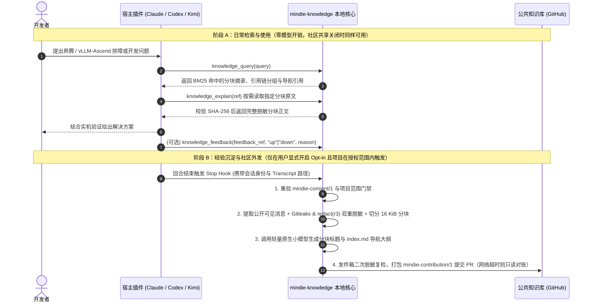

# 领域知识闭环总览（MindIE Domain Loop）

**中文** | [English](mindie-loop.md) · [返回文档中心](README.md)

本文用通俗易懂的语言串起 `mindie-knowledge` 的完整工作闭环：从用户如何控制授权开关、如何从公开对话中提取经验、如何在本地做秒级 BM25 检索，到如何与远端公共知识库（如 [`knowledge-vllm-ascend`](https://github.com/mindie-agent/knowledge-vllm-ascend)）双向同步与反馈。

---

## 1. 一图看懂领域知识闭环

---

## 2. 一次显式选择，跨会话持久生效

用户不需要在每次启动会话时都回答一遍“是否开启社区贡献”：
- **单次引导**：插件安装后首次进入原生入口（Claude Code / Kimi 中的 `/mindie-agent` 或 Codex 中的 `$mindie-agent`）时，仅询问一次贡献意愿，并将选择保存在 `mindie-consent/1` 配置文件中。
- **默认零采集（Opt-in）**：默认状态下社区共享处于关闭状态（`enabled=false`）。关闭时，Stop Hook 直接短路返回，**不读取任何对话记录、不运行脱敏扫描、不调用摘要模型、也不产生任何外发草稿**；同时只读检索（`knowledge_query` / `knowledge_explain`）与公共知识库同步（`sync`）依然完全可用。
- **随时可改，绝不回溯**：用户可随时通过同一入口开启或关闭共享。中途关闭会立即取消正在排队或运行的采集与未发送批次，但保留已落盘草稿；重新开启后只采集新产生的对话，**绝不会偷偷回填关闭期间的历史记录**。

---

## 3. 实时授权门禁（The Gate）

为了防止配置文件被意外篡改或损坏时发生误外发，`mindie-knowledge` 在**每次读取 Transcript 前、每次启动摘要小模型前、以及每次向外部写入前**，都会实时重读共享设置文件与绝对路径指向的 `mindie-consent/1`：

$$\text{capture\_allowed} = \text{有效插件租约} \land \text{共享已开启} \land \text{项目根目录在授权范围内} \land \text{consent 明确允许贡献}$$

- **区分“未开启”与“配置损坏”**：如果配置文件缺失、无法读取或 JSON 格式损坏，系统会将其作为明确的**授权故障（Authority Fault）**上报，并暂停已接收的后台工作（保留已生成的模型结果，等待修复后恢复），**绝不会把配置损坏当成“首次安装”去重新弹窗或重置用户数据**。

---

## 4. 任务知识包结构与两级按需阅读

无论是本地采集生成的草稿，还是从公共知识库同步下来的正式条目，都采用统一的**清单 + 不可变分块**结构：

- **任务导航清单（`tasks/<task-id>/index.md`）**：
  使用 `mindie-material-task/1` 格式，内嵌 `mindie-entry/3` 检索头，记录每个分块的 `block_id`、`sha256`、标题、摘要以及任务整体导航。
- **无损脱敏原文分块（`tasks/<task-id>/blocks/<block-id>.md`）**：
  使用 `mindie-material-block/1` 格式，保存按 16 KiB 上限切分的公开对话原文。**正文字节永远以普通 Markdown 文件为准**，`state-v4.sqlite3` 仅保存头部指针、游标、队列与回执。

### 为什么 `knowledge_explain` 分两步读？

Agent 调用 `knowledge_explain(ref)` 时支持两种引用形态：
1. **读任务目录（`mindie://DOMAIN/TASK`）**：返回当前任务的导航大纲、`current_revision`、总分块数 `block_count` 和第一块引用 `first_block_ref`，**不会一次性把几十个分块拼成巨型文本塞爆上下文**。
2. **读具体分块（`mindie://DOMAIN/TASK/blocks/<block-id>@<file-sha256>`）**：先核对当前任务清单中确实包含该分块且文件 SHA-256 完全匹配，再返回该分块的完整内容以及前后相邻分块引用（`previous_block_ref` / `next_block_ref`），方便 Agent 像翻书一样前后浏览。

> [!IMPORTANT]
> **清晰的错误语义**：如果某个分块已在后续修订中被替换，返回 `removed_or_superseded`；如果整个任务已被上游撤下，返回 `withdrawn`；如果本地文件缺失或哈希不匹配，直接报 `material_corrupt` 错误，绝不伪装成空内容。

---

## 5. 本地 BM25 检索与引用链分组（`knowledge_query`）

`mindie-knowledge` 内嵌了固定版本的 ReMe Markdown 分块器、文件引用图与 BM25 索引：
- **全文覆盖、增量启动**：不仅搜索任务标题和短导航，还搜索每一个正文分块的完整内容（保留技术标识符与中文分词边界）。每个变更分块的分词与词频会压缩缓存在 SQLite 检查点行中，服务重启时无需重新切分旧文件。
- **单源引用链自动聚合（Citation Grouping）**：如果分块 B 在正文中显式引用了同领域的源任务 A（`mindie://DOMAIN/<task-id>@<revision>`），且源任务 A 本身也命中了查询中的所有关键词，检索结果会将它们聚合为一个引用组（以源任务 A 为锚点，附带最多 2 条相关匹配预览与 `related_next` 翻页令牌）。
- **翻页续查（Continuation）**：当 `related_count` 大于预览条数时，Agent 可调用 `knowledge_query(continuation=related_next, limit=20)` 获取组内剩余匹配项。
- **引用不等于背书**：引用分组和 `related_count` 仅用于整理阅读脉络，**绝不会因为被引用次数多就人为抬高检索打分，也不代表对技术结论的真理性认证**。

---

## 6. 独立版本化有用性反馈（`knowledge_feedback`）

Agent 在实际参考某条知识完成任务后，可调用 `knowledge_feedback(ref, rating, reason?)` 提交 `up` 或 `down` 评价：
- **必须绑定观测修订**：`ref` 必须使用查询时返回的 `feedback_ref`（形如 `mindie://DOMAIN/<task-id>@<observed-revision>`），拒绝使用不带修订号的读取引用，防止延迟提交的评价误挂到更新后的版本上。
- **保护隐私**：导出的公开投票文件（`feedback/*.json`）仅携带随机生成的不透明匿名根标识 `root_id`，本地原生会话 ID 绝不离开本机。社区共享关闭期间记录的投票仅保留在本地（`publishable=0`），不会外发。

---

## 7. 确定性发件箱与公共知识源同步

### 自动打包与只读对账（Outbox）
- 当空闲计时器到期（默认 300 秒）或任务结束时，发件箱将已完成全块索引的本地草稿与可发布投票合并为一个 `mindie-contribution/1` 批次，对每个条目做最后一次出站脱敏扫描（若某条目命中敏感词，仅隔离该条目，不阻塞同批其他正常条目）。
- 若推送或创建 PR 时遇到网络中断导致结果未知（`unknown`），系统保留冻结的发送包，并在后续调度周期按退避间隔执行**只读远程 PR 对账**（检查目标分支 Head 或 Git 祖先关系），绝不盲目重推或重写。

### 独立无模型同步（`mindie-knowledge sync`）
- `sync` 命令完全不依赖大模型，即使关闭了社区共享也可随时运行。
- 它通过单个持久 `git cat-file --batch` 进程流式读取候选提交中的每个 Git Blob，逐一校验 `publication-contract.json`、目录拓扑、UTF-8/LF 编码、分块 SHA-256 与隐私脱敏规则，并按路径记录校验检查点（断点续验，无需从零重跑）。
- 只有当整个候选提交 100% 校验通过后，才在一次极短的本地事务中原子切换当前可见视图；若上游删除了某个任务包，本地自动将其转化为撤下标记（`withdrawn`）。
