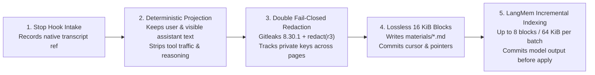

# Public Transcript Capture & Incremental Indexing

[中文](public-transcript-capture.zh.md) | **English** · [Back to Documentation Center](README.en.md)

This guide explains how `mindie-knowledge` extracts visible conversation turns from native host transcripts when community sharing is enabled, applies double fail-closed privacy redaction, splits messages into lossless Markdown blocks, and builds retrieval navigation incrementally.

---

## 1. Capture Pipeline Overview

---

## 2. Deterministic Public-Message Projection

`public-transcript` is the single capture pipeline. Each host plugin supplies its own deterministic `transcript_adapter`:
- **Reads Only the Bound Session Transcript**: The background worker reads only the exact transcript path forwarded by the Stop Hook—never scanning historical session folders or guessing neighboring files.
- **Strips Internal Noise**: Only authorized **user inputs**, **visible assistant progress**, and **final answers** are kept. Tool call arguments/results, hidden reasoning traces, system/developer prompt injections, and foreign task history are deterministically excluded.
- **No Truncation of Long Messages**: Paging bounds memory between records without truncating large messages; a complete public turn is always read whole. Malformed records or unverifiable ownership leave the cursor unchanged and surface an explicit error.

---

## 3. Double Redaction & Lossless 16 KiB Blocks

Before any text is written to `materials/` or sent to the summary worker, it must pass two local deterministic scanners:
1. **Pinned Gitleaks (`8.30.1`)**: Verified at installation time (capture never downloads a binary over the network);
2. **Built-in `mindie_knowledge.redact` (`r3`)**: Redacts credentials, private key blocks (tracking unclosed key boundaries across page slices), internal IPv4/IPv6 addresses, numbered machine identifiers, `<user>@<host>` login targets, personal home paths, and internal ticket IDs.

### Why Models Never Rewrite Body Text
- Sanitized public messages are split along UTF-8 character boundaries into lossless blocks of at most **16 KiB** (`mindie-material-block/1`) under `materials/`.
- **No model ever generates, shortens, or rewrites block bodies.** Stack traces, environment variables, operator flags, and numerical results remain 100% faithful to the redacted transcript.

---

## 4. Incremental Navigation Indexing & `SummaryLedger`

To help Agents scan search results quickly, a separate worker invokes **LangMem `0.0.30`** through the host's lightweight native model route to generate one title/summary pair per new block plus an updated task navigation summary:

- **Bounded Batches, Complete Coverage**: Each batch processes at most **8 complete blocks** and **64 KiB** of rendered user prompt. Every block is indexed in order—no middle blocks are sampled away, and there is no whole-history model call at the end.
- **Commit Output Before Local Apply (Zero Paid Replay)**:
  The durable `SummaryLedger` tracks `prepared`, `invoking`, `returned`, `complete`, `failed`, and `outcome-unknown` states. **Returned model output and token usage are committed to SQLite before metadata redaction or manifest updates run.**
  - If a subsequent scanner check, authority check, or local file update fails, recovery **reuses the saved model output** without making another paid model call.
  - Interrupted or failed model calls (`failed` / `outcome-unknown`) are never automatically retried by the background scheduler; explicit retry preserves prior attempt records and token counters.
- **Unindexed Material Is Never Exported**: Until every block in a task package is indexed, the package remains unready for export—preventing raw excerpts from masquerading as indexed contributions.

---

## 5. Internal Lifecycle Ownership

Inside `mindie_knowledge/loop/`, each component has a single clear responsibility:
- **`Engine`**: Schedules work and re-verifies native consent before every read, model call, and outbound write;
- **`OperationOwner`**: Assigns an independent identity, generation counter, and cancellation token to each live capture, index, staging, and publication operation; revoking consent cancels prior-generation work immediately;
- **`IndexQueue` & `SummaryLedger`**: Coordinate queue state transitions and model attempt receipts within the existing SQLite transaction;
- **`PublicationWorker`**: Streams frozen packages one file at a time through hash-bound views, submits or reconciles PRs, and retires staging files once confirmed.
