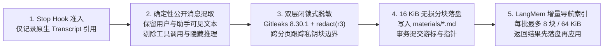

# 公开对话采集与增量索引（Public Transcript Capture & Indexing）

**中文** | [English](public-transcript-capture.md) · [返回文档中心](README.md)

本文详细说明当用户开启社区共享后，`mindie-knowledge` 如何从宿主客户端的原生会话记录中提取公开对话、执行双层确定性隐私脱敏、切分为无损 Markdown 分块，并通过轻量级小模型增量生成检索导航。

---

## 1. 采集流水线全景

---

## 2. 确定性公开消息筛选（不猜格式、不收噪音）

`public-transcript` 是唯一的采集管线，由各宿主插件提供对应的确定性解析器（`transcript_adapter`）：
- **只读当前绑定的会话文件**：后台工作器仅读取 Stop Hook 传入的原生 Transcript 路径，绝不扫描历史会话目录或猜测相邻会话。
- **精准剥离内部噪音**：解析器只提取经过授权的**用户输入（User Input）**、**助手可见进展（Visible Assistant Progress）**与**最终回答（Final Answer）**；工具调用参数与返回值、隐藏思维链（Reasoning）、系统/开发者提示词注入以及非当前任务的历史记录一律被确定性剔除。
- **长消息完整保留**：分页读取仅用于控制单次内存开销，哪怕单条公开消息超过分页大小也会完整读取，绝不会做首尾截断或丢弃中间段落。若遇到损坏记录或无法验证归属的条目，游标保持不动并显式报错。

---

## 3. 双层隐私脱敏与 16 KiB 无损分块

在任何文本写入本地 `materials/` 目录或送入摘要小模型之前，必须先通过两道本地确定性脱敏防线：
1. **固定版本 Gitleaks（`8.30.1`）**：由安装器预先校验二进制与许可证（采集过程绝不联网下载扫描器）；
2. **内置规则集 `mindie_knowledge.redact`（`r3`）**：覆盖凭据、私钥片段（支持跨分页跟踪未闭合私钥块）、内网 IPv4/IPv6、编号机器名、`<user>@<host>` 登录串、个人主目录路径与内部工单号。

### 为什么坚持“零大模型改写正文”？
- 脱敏后的公开消息按 UTF-8 字符边界无损切分为最多 **16 KiB** 的不可变分块文件（`mindie-material-block/1`），存放在本地 `materials/` 目录下。
- **没有任何大模型会参与正文的生成、缩写或改写**。这样既保证了报错栈、环境变量、算子参数与实验数据的 100% 原汁原味，也杜绝了大模型产生幻觉篡改技术事实的可能。

---

## 4. 增量导航索引与防重放账本（`SummaryLedger`）

为了方便 Agent 在检索时快速浏览任务全貌，后台独立工作器使用 **LangMem `0.0.30`** 调用宿主原生轻量模型（例如 Codex 宿主内部固定使用经过验证的轻量路由），为新增分块生成检索元数据：

- **有界批次，全量覆盖**：每个批次最多包含 **8 个完整分块** 且渲染后的用户提示词不超过 **64 KiB**。所有分块按序分批建立索引，绝不抽样丢弃中间分块，也不在结尾对整篇长历史做全量重读。
- **结果先持久化，再本地应用（杜绝重复计费）**：
  持久化账本 `SummaryLedger` 清晰区分 `prepared`、`invoking`、`returned`、`complete`、`failed` 与 `outcome-unknown` 状态。**一旦小模型返回输出与 Token 用量，系统第一时间将其提交到账本**，然后再执行元数据脱敏扫描与清单更新。
  - 如果后续扫描、权限检查或本地文件更新意外中断，恢复流程会**直接复用已保存的模型输出**，绝不会再次调用付费模型！
  - 如果调用在返回前中断（状态为 `failed` 或 `outcome-unknown`），正常调度器绝不自动重试；仅在用户或维护者发起显式重试时才重新调用，且历史尝试次数与已知 Token 统计均完整保留。
- **未完成索引不冒充成品**：只要还有任何一个分块尚未完成索引，该任务包就会保持未就绪状态，禁止进入外发批次，绝不会用原始摘录冒充已完成索引的知识包。

---

## 5. 内部组件职责边界

在 `mindie_knowledge/loop/` 内部，各模块保持单一职责：
- **`Engine`**：负责调度后台任务并在每次关键操作前重验原生授权门禁；
- **`OperationOwner`**：为每次活跃的采集、索引、打包与外发分配独立的操作身份、代次（generation）与取消令牌；用户关闭共享时立即取消旧代次任务；
- **`IndexQueue` 与 `SummaryLedger`**：在同一 SQLite 事务中管理分块索引队列与模型调用回执；
- **`PublicationWorker`**：按哈希绑定的文件视图逐个读取冻结包、执行发件箱提交与只读对账，并在收到上游确认后清理临时暂存区。
