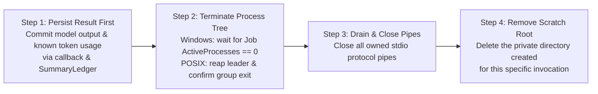

# Summary Process & Temporary Profile Ownership

[中文](summary-process-ownership.zh.md) | **English** · [Back to Documentation Center](README.en.md)

When `mindie-knowledge` invokes a host CLI (such as the Codex or Claude Code lightweight summary route) to index new material blocks, the host CLI often spawns helper subprocesses that read and write a temporary profile directory.

This guide explains why **temporary directory cleanup belongs exclusively to the core runtime rather than the adapter wrapper**, and how a strict four-step teardown sequence eliminates race conditions between descendant processes and directory deletion.

---

## 1. Why Adapter-Side Cleanup Races with Live Writers

In real host executions, receiving a terminal JSON result on stdout **does not prove that all child and grandchild processes have exited**:
- Codex intentionally flushes its result before its background process tree finishes shutting down;
- Claude Code reaps its direct child while inherited-group descendants may still be flushing logs or state files into the temporary profile directory.

If the adapter deletes the temporary profile directory immediately upon reading the result, it races with live descendant writers—causing file-in-use errors (especially on Windows) or masking a valid, already-paid model result behind a cleanup exception.

---

## 2. Single Cleanup Owner & Four-Step Teardown Order

To eliminate this race, **only `bounded_run` calls with a durable `on_result` callback create and delete the private scratch root**. The adapter creates its temporary profile inside that root and leaves deletion entirely to `mindie-knowledge` core (which retains its own local path reference and never accepts an arbitrary deletion path from a worker).

Whether an invocation succeeds, fails, or is cancelled, teardown always follows this exact **four-step order**:

### Three Guarantees of This Ordering
1. **Cleanup Errors Never Trigger Paid Model Replay**: Because the model output and token usage are committed to `SummaryLedger` in Step 1, any secondary error during tree termination or directory deletion preserves the saved result and never re-invokes the model.
2. **Zero Active Writers During Deletion**: Step 4 runs only after the OS confirms that the entire Windows Job (`ActiveProcesses == 0`) or POSIX process group has exited and all pipes are closed.
3. **Private Permissions**: The scratch root is created with private POSIX permissions (`0700`) or the current Windows user's SID ACL.

---

## 3. Internal Ownership Verification (`MINDIE_SUMMARY_SCRATCH`)

Core passes an internal parent/worker declaration via `MINDIE_SUMMARY_SCRATCH` (containing the schema, owner PID, private scratch root, and Windows Job name):
- **Sanitized Across Boundaries**: Every spawn clears any inherited `MINDIE_SUMMARY_SCRATCH` value before creating its own; service launch configs reject external injection of this variable, and adapters strip it from the environment before spawning the native model CLI.
- **Platform Ownership Proof**:
  - **POSIX (macOS / Linux)**: The adapter verifies its direct parent PID and process group (PGID);
  - **Windows**: Because a Python virtual-environment launcher (`python.exe` redirector) may sit between the parent and the actual interpreter, direct PPID equality is not a reliable check. Instead, core assigns the suspended worker to a randomly named Job Object (`KILL_ON_JOB_CLOSE`) before resuming it; the adapter briefly opens that exact named Job for query, verifies its own membership, and closes the query handle before invoking the model.
