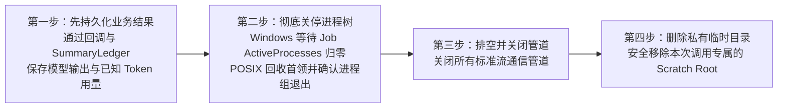

# 摘要进程与临时目录归属（Summary Process & Scratch Ownership）

**中文** | [English](summary-process-ownership.md) · [返回文档中心](README.md)

当 `mindie-knowledge` 调用宿主原生 CLI（如 Codex 或 Claude Code 的轻量摘要路由）为新增分块生成导航索引时，宿主 CLI 往往会在临时配置目录（Profile / Scratch Directory）下启动多个辅助子进程。

本文说明为什么**临时目录的清理权必须归属于核心运行时（Core）而非外层适配器脚本**，以及我们如何通过严格的四步回收顺序彻底消除“边写边删”的并发竞态。

---

## 1. 为什么适配器不能自己删临时目录？

在真实运行中，当宿主 CLI 打印出最终的 JSON 摘要结果时，**并不意味着它的所有子进程或孙进程都已经退出了**：
- 例如，Codex 会在后台子进程树完全关闭前就提前向标准输出交付结果；
- Claude Code 在回收直接子进程后，同进程组的后代进程可能仍在向临时 Profile 目录写入缓存或退出日志。

如果外层适配器脚本在拿到结果的瞬间就立刻执行 `rmtree` 删除临时目录，就会与尚未退出的后代进程发生文件锁冲突（尤其在 Windows 上会导致删除失败或抛出异常），甚至因为清理报错而把原本已经成功的付费模型结果弄丢！

---

## 2. 唯一清理所有者与严格四步回收顺序

为了彻底解决这一问题，`mindie-knowledge` 规定：**只有带持久化结果回调（`on_result`）的 `bounded_run` 核心调用才负责创建和删除私有临时根目录（Scratch Root）**。适配器只在该目录内创建子目录，把最终删除权完全交给核心运行时。

无论正常完成、超时取消还是执行失败，核心都严格按照以下**四步顺序**收尾：

### 这一顺序带来的三大保障
1. **绝不因为清理失败而重放付费调用**：业务结果和 Token 用量在第一步就已经安全落盘。哪怕第四步删除临时目录时遇到权限或占用错误，已保存的结果与主异常也完好无损，绝不会触发第二次模型调用。
2. **删除时没有任何残留写进程**：只有在确认整个 Windows Job（`ActiveProcesses == 0`）或 POSIX 进程组完全退出、且所有管道关闭后，才执行目录删除，彻底消除了“边写边删”竞态。
3. **路径安全隔离**：核心只删除自己创建的私有临时目录引用，绝不接受子进程返回任意路径去执行删除。

---

## 3. 内部父子进程归属校验（`MINDIE_SUMMARY_SCRATCH`）

核心通过内部环境变量 `MINDIE_SUMMARY_SCRATCH` 向受管摘要子进程传递归属声明（包含 Schema、父进程 PID、私有临时根目录路径以及 Windows 命名 Job 标识）：
- **防伪造与防泄漏**：每次启动新子进程前都会先清除继承的同名变量；服务启动配置不允许外部注入该变量，且适配器在真正拉起原生大模型进程前会将其从环境变量中移除。
- **跨平台归属核验**：
  - **POSIX（macOS / Linux）**：适配器直接核对父进程 PID 与所属进程组（PGID）；
  - **Windows**：由于 Python 虚拟环境启动器（venv redirector）会作为中间层进程启动真正的 `python.exe`，直接核对 PPID 并不准确。因此核心会创建一个带随机名称的命名 Job Object，在挂起状态下将子进程放入 Job；适配器启动后短暂打开该命名 Job 验证自身确实在 Job 内，验证通过后立即关闭查询句柄，既证明了归属关系，又完全保留了 `KILL_ON_JOB_CLOSE` 的自动回收语义。
