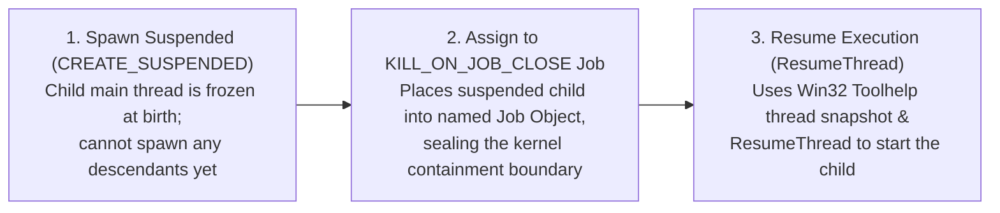

# Windows Process Tree Ownership

[中文](windows-process-ownership.zh.md) | **English** · [Back to Documentation Center](README.en.md)

Managing subprocess trees on Windows involves two classic pitfalls:
1. **Fast Descendant Escape**: If a parent spawns a child normally and attaches a Windows Job Object afterward, a fast child can spawn a grandchild before Job assignment completes—allowing the grandchild to escape containment;
2. **Broken PID Trees & Pipe Hangs After Leader Exit**: Once an intermediate leader process (such as a Python virtual-environment launcher) exits, PID-based `taskkill /T` can no longer locate its surviving grandchildren. Even worse, a surviving grandchild holding an inherited stdout/stderr pipe keeps the parent's pipe reader blocked indefinitely.

This guide explains how `mindie_knowledge.windows_process.spawn_owned` eliminates both failure modes.

---

## 1. Three-Step Atomic Spawn (`spawn_owned`)

Both summary worker invocations and community Git / `gh` subprocesses on Windows launch through `mindie_knowledge.windows_process.spawn_owned`:



- **Zero Escape Window**: Because the child is placed inside a `JOB_OBJECT_LIMIT_KILL_ON_JOB_CLOSE` Job Object while still suspended (`CREATE_SUSPENDED`), every child and grandchild it subsequently spawns—across any number of venv redirectors or wrapper scripts—is unconditionally contained within that Job.
- **Reliable Cleanup After Leader Exit**: During teardown, timeout, or cancellation, `mindie-knowledge` terminates the owned Job handle directly. Even if the original child process already exited, the Windows kernel immediately terminates all remaining descendants in the Job, releasing any inherited stdio pipes so pipe readers never hang.

---

## 2. Live Subprocess Regression Matrix

The focused Windows regression suite exercises real Win32 processes and Job Objects without mocking process creation, liveness, or Job assignment:

```bash
python3 -m pytest -q tests/test_windows_process_ownership.py
```

The test matrix covers both callers (**summary worker execution** and **community Git/gh subprocesses**) across two critical terminal scenarios:
1. The leader process exits normally while leaving a detached grandchild running;
2. A grandchild holds the inherited output pipes open past the execution deadline.

In every case, `spawn_owned` guarantees that all descendants exit cleanly and pipes close promptly without disturbing the independent background knowledge service.

References: [CreateToolhelp32Snapshot](https://learn.microsoft.com/en-us/windows/win32/api/tlhelp32/nf-tlhelp32-createtoolhelp32snapshot) · [Thread32First](https://learn.microsoft.com/en-us/windows/win32/api/tlhelp32/nf-tlhelp32-thread32first)
