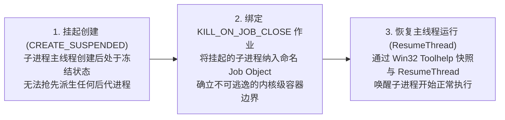

# Windows 进程树强归属（Windows Process Tree Ownership）

**中文** | [English](windows-process-ownership.md) · [返回文档中心](README.md)

在 Windows 上管理子进程树有两个经典陷阱：
1. **快孙进程逃逸（Fast Descendant Escape）**：如果先以普通方式启动子进程，再去创建并绑定 Windows Job Object，子进程在绑定完成前快速拉起的孙进程就会逃出 Job 的管辖；
2. **首领退出后断链与管道挂死**：一旦首领子进程（如虚拟环境启动器 `python.exe`）提前退出，基于 PID 的 `taskkill /T` 就再也找不到它留下的孙进程；而存活的孙进程如果继承了标准输出管道句柄，还会导致父进程的管道读取器永远阻塞挂死。

本文说明 `mindie_knowledge.windows_process.spawn_owned` 如何从根源上解决这两个问题。

---

## 1. `spawn_owned` 的三步原子启动机制

无论是摘要小模型调用还是社区共享的 Git / `gh` 子进程，在 Windows 上均统一通过 `mindie_knowledge.windows_process.spawn_owned` 启动：



- **零逃逸窗口**：因为子进程在 `CREATE_SUSPENDED` 状态下连第一条指令都还没执行就被放进了带有 `JOB_OBJECT_LIMIT_KILL_ON_JOB_CLOSE` 标志的 Job Object，它后续派生的任何子进程、孙进程（无论隔了多少层虚拟环境重定向器或批处理包装）都无条件属于同一个 Job。
- **首领退出依然可靠回收**：当操作完成、超时或被取消时，核心直接关闭并终止所持有的 Job 句柄。即使最初的首领进程早已退出，Windows 内核也会立即杀死 Job 中剩余的所有后代进程，从而自动释放它们继承的标准输出/错误管道，彻底杜绝管道读取挂死。

---

## 2. 真实子进程回归验证矩阵

仓库内的专项测试直接拉起真实的 Windows 子进程与孙进程（不使用 Mock 伪造进程存活或 Job 绑定）：

```bash
python3 -m pytest -q tests/test_windows_process_ownership.py
```

测试矩阵同时覆盖**摘要执行器**与**社区 Git/gh 子进程**两类调用方，并验证两种典型棘手场景：
1. 首领进程正常退出，但留下了已脱离控制台的后代进程；
2. 后代进程一直持有继承的标准输出管道不释放，试图阻塞父进程清理。

在所有场景下，`spawn_owned` 均能确保后代进程被干净终止、管道正常排空关闭，且不影响后台常驻的知识服务进程。
