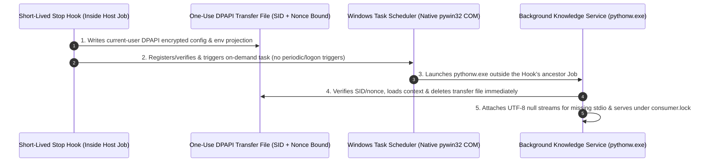

# Windows Knowledge Service Host

[中文](windows-service-host.zh.md) | **English** · [Back to Documentation Center](README.en.md)

On native Windows, when a host client (such as Codex or Claude Code) invokes a turn-ending `Stop Hook`, the host often runs that Hook inside an ancestor Windows Job configured with `KILL_ON_JOB_CLOSE` and no breakaway permission. As soon as the short-lived Hook exits, the Windows kernel terminates any ordinary child process it spawned.

This guide explains how `mindie-knowledge` uses **Windows Task Scheduler COM APIs + one-use DPAPI context transfer + windowless stream guards** so the background knowledge service survives short Hook exits cleanly and securely.

---

## 1. Why an On-Demand Task Scheduler Host?

- **Surviving Host Job Termination**: An on-demand Task Scheduler action runs under the current user's interactive login token outside the Hook's ancestor Job, allowing `mindie-knowledge` to complete redaction, chunking, and indexing after the Hook returns.
- **Strictly On-Demand (Zero Polling Triggers)**: The registered task defines **no periodic or logon triggers**—it runs only when explicitly started by a service operation.
- **Direct `pywin32` COM Calls (No Slow PowerShell Spawns)**: Task lookup, ACL verification, registration, start, and removal use native `pywin32` COM and Win32 security APIs rather than spawning PowerShell subprocesses (reducing two task lookups during a Windows Stop path from 5.16s to 1.57s in controlled benchmarks).

---

## 2. One-Use DPAPI Context Transfer (Zero Credentials in Task XML)

To pass configuration paths and selected environment variables across the Task Scheduler boundary without exposing secrets in Task XML metadata:
1. **Allowlisted Projection (`service_launch_context`)**: Adapters declare only their profile paths (`paths`) and a finite list of optional environment variable names (`environment`, such as provider auth variable names or `HTTPS_PROXY`).
2. **DPAPI Encryption & Single-Use Nonce**: Present values are encrypted with current-user DPAPI into a SID-private transfer file bound to the user SID, configuration fingerprint, launch nonce, and original working directory.
3. **Immediate Deletion & Ambient Cleanup**: Upon startup, the service host validates and deletes the transfer file, clears declared ambient variables first (so an explicitly unset caller variable never inherits a stale value from the Scheduler environment), and applies the caller projection.
4. **Bypassing the 260-Character `WorkingDirectory` Limit**: Task XML omits the 260-character `WorkingDirectory` field; instead, the service host `chdir`s to the bound working directory from the verified transfer file and uses Windows extended-length paths (`\\?\`) for data, manifests, locks, and diagnostics.

---

## 3. Startup Serialization, Uncertain Starts & Exact Retirement

- **Durable Intent & No Blind Replay**: Registration and `Start` intents are persisted before calling Task Scheduler, verifying the exact task XML, user SID, single `Exec` action, and principal RunLevel. If `Start` is accepted by the manager but writing the local receipt fails (`start_receipt_write_failed`), the encrypted transfer file is retained for the already-started instance—**uncertainty never triggers a duplicate `Start` call**.
- **Exact-Config Retirement**: During idle retirement or uninstall, the runtime bars new admission, waits for the active consumer to exit safely, and removes only the verified task.
- **Provably Superseded Leftover Retirement**: An update that changes the engine configuration while the service is off leaves the previous generation's launch record and registered task behind; both previously wedged every later start as `foreign_launch_record` / `foreign_task`. A leftover is retired (with a visible `stale_launch_record_retired` / `stale_registered_task_retired` diagnostic) and re-registered fresh only when it is provably from the same ownership chain (same user SID, same install manifest identity, strict single-action task shape) **and** provably inert — not Running/Queued, with a terminal receipt, a dead recorded pid, or a never-run/consumed attempt nonce. A live recorded pid vetoes every other proof; any identity mismatch keeps failing closed. `cli stop` against an already-dead endpoint reports `not-running` and retires the same provably inert leftovers, reporting any cleanup failure alongside the completed stop.

---

## 4. Windowless `pythonw.exe` Stream Guards & Transparent Startup Errors

- **Preventing `None` Stream Crashes in `pythonw.exe`**: Unlike console processes, `pythonw.exe` can leave `sys.stdin`, `sys.stdout`, and `sys.stderr` set to `None`, which crashes libraries (including ReMe's logger initialization) that expect valid stream objects. Before loading components, the service host attaches a real UTF-8 null-device file handle (`DEVNULL`) to any missing stream and closes only the handles it created on exit.
- **Preserving Root-Cause Startup Errors Across Process Boundaries**: If a component fails during startup, its static stage code, exception class, and cause are allowlist-validated and returned in the attempt receipt—so the caller sees the actual component failure rather than a generic host timeout.
