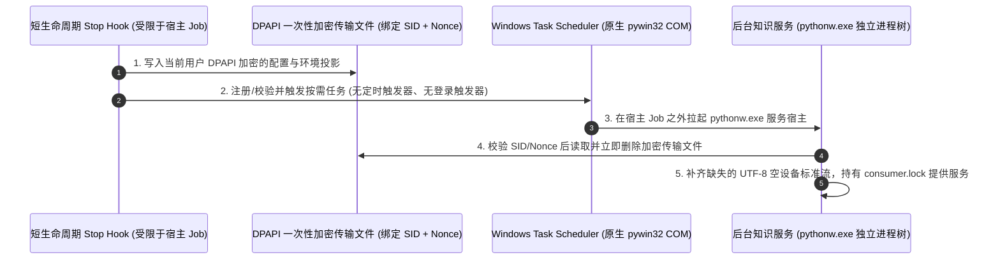

# Windows 知识服务宿主（Windows Knowledge Service Host）

**中文** | [English](windows-service-host.md) · [返回文档中心](README.md)

在原生 Windows 环境下，当宿主客户端（如 Codex 或 Claude Code）触发回合结束的 `Stop Hook` 时，外层宿主往往会把整个 Hook 放在一个带有 `KILL_ON_JOB_CLOSE` 且禁止脱离（No Breakaway）的祖先 Windows Job 中。一旦短短几百毫秒的 Hook 退出，它直接启动的任何普通后台子进程都会被 Windows 内核一并强行杀死。

本文说明 `mindie-knowledge` 如何利用 **Windows Task Scheduler（计划任务）COM 接口 + DPAPI 单次加密上下文 + 无窗口流保护**，让后台知识服务在原生 Windows 上既能独立存活，又保持严密的权限隔离与可观测性。

---

## 1. 为什么使用 Task Scheduler 按需宿主？

- **脱离短 Hook 的祖先 Job 限制**：通过 Windows Task Scheduler 启动的动作运行在当前用户的交互式登录令牌下，天然独立于短 Hook 所在的临时 Job，从而在 Hook 返回后继续安全完成对话脱敏、分块与索引。
- **纯按需触发，零后台轮询**：注册的任务**没有任何定时触发器（Periodic Trigger）或开机登录触发器（Logon Trigger）**，只在业务实际调用时按需拉起。
- **原生 COM 接口，告别慢速 PowerShell**：所有任务查询、ACL 检查、注册、启动与删除均直接通过 `pywin32` 原生 COM 与 Win32 安全 API 完成，不再每次启动 PowerShell 子进程（实测将单次 Stop 过程中的两次任务查询耗时从 5.16 秒降低至 1.57 秒）。

---

## 2. DPAPI 单次加密上下文传输（零凭据落盘 XML）

为了把调用方的必要配置路径与环境变量安全传给 Task Scheduler 宿主，同时确保计划任务 XML 元数据中绝不包含任何敏感信息：
1. **白名单投影（`service_launch_context`）**：适配器在引擎配置中显式声明允许跨边界传递的配置文件路径映射（`paths`）和有限的环境变量名列表（`environment`，如选定的模型认证变量名或 `HTTPS_PROXY`）。
2. **DPAPI 加密与一次性 Nonce**：只有调用方进程中实际存在的白名单变量会被当前用户 DPAPI 加密写入受 ACL 保护的传输文件，并绑定用户 SID、配置指纹、一次性 Nonce 与原始工作目录。
3. **消费后立即删除与环境净化**：服务宿主启动后，先校验并删除该加密传输文件，然后清除宿主环境中可能残留的同名旧变量，再应用调用方传入的值（确保调用方显式未设置的代理或变量不会继承宿主的陈旧环境）。
4. **绕过 260 字符工作目录限制**：计划任务 XML 省略了受 260 字符限制的 `WorkingDirectory` 字段，改由服务宿主在校验完加密传输文件后直接切换至绑定的原始工作目录，并对数据、清单、锁与诊断路径全程启用 Windows 扩展长路径支持。

---

## 3. 启动幂等性、未知状态保护与安全退役

- **先记意图，绝不盲目重拉**：每次向 Task Scheduler 发起注册或 `Start` 前都会先写入持久化意图，并严格核对任务 XML、用户 SID、唯一 Exec 动作与权限级别。如果 `Start` 请求已被接收但本地回执写入失败（报告为 `start_receipt_write_failed`），加密传输文件会保留供该已启动实例消费，**绝不会因为超时或观察不到就盲目发起第二次 `Start`**。
- **精确退役（Exact Retirement）**：当服务空闲退役或卸载时，系统先冻结新任务准入并等待当前消费者安全退出，随后仅删除经过身份校验的计划任务并确认其已不存在。

---

## 4. `pythonw.exe` 无窗口标准流保护与透明错误传递

- **防止 `None` 标准流导致第三方库崩溃**：在 Windows 下，无窗口进程 `pythonw.exe` 往往会将 `sys.stdin`、`sys.stdout` 和 `sys.stderr` 设为 `None`，这会导致依赖标准输出流配置日志器的组件（如 ReMe）在初始化时直接崩溃。为此，服务宿主在加载任何业务组件前，会自动为缺失的标准流绑定真实的 UTF-8 空设备文件句柄（`DEVNULL`），并在退出时负责关闭。
- **跨进程保留真实启动错误**：当后台组件在启动阶段报错时，其静态阶段码、异常类型与原因会通过白名单校验后写回当前尝试的结果回执中，确保前台轮询调用方看到的是**真实的组件故障原因**，而不是被笼统的宿主连接超时所掩盖。
